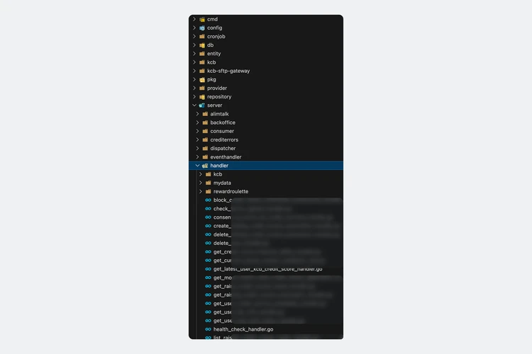
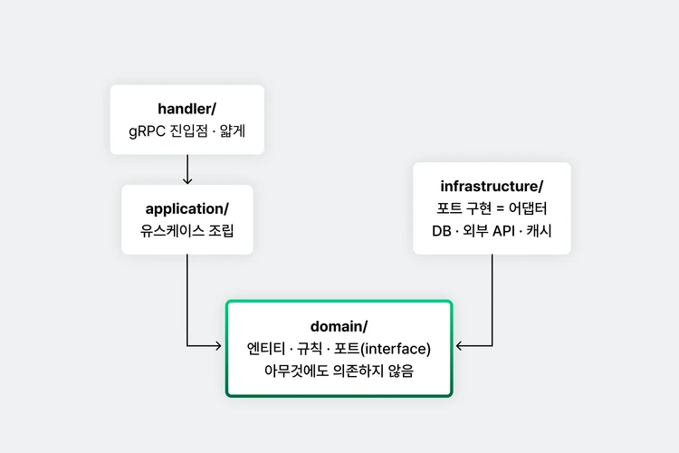
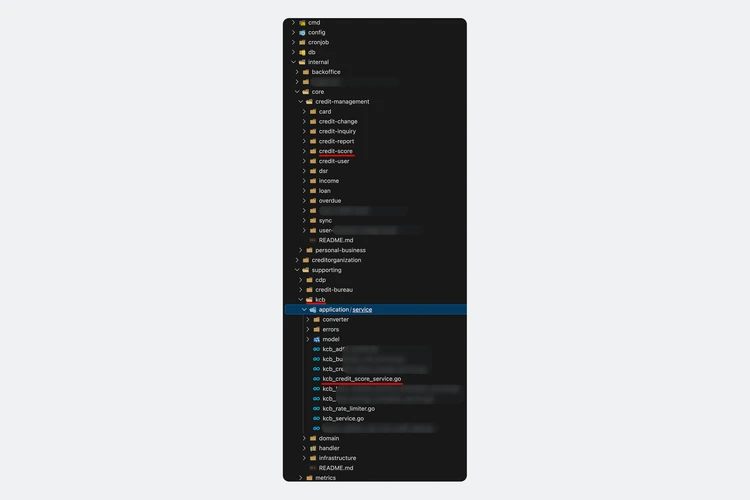
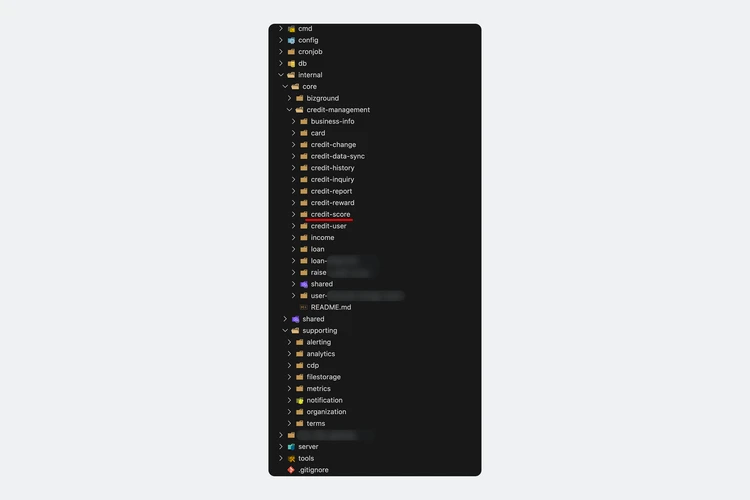
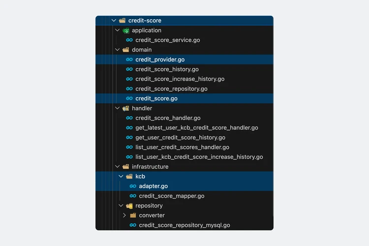

# AI 코딩 시대, DDD가 더 필요해진 이유

> ## Excerpt
> Go 서비스에 DDD-lite와 Clean Architecture를 적용하면 뭐가 다를까? 안녕하세요, 금융쇼핑 PA 서버 Tech Lead 김지원입니다. 뱅크샐러드 서버는 대부분 Go로 만든 마이크로서비스입니다. 제가 입사하기 전 얘기라 정확하진 않은데, 마이크로서비스니까 각 서비스…

---
## [](https://corp.banksalad.com/blog/tech/banksalad-ddd-in-ai-era/#go-%EC%84%9C%EB%B9%84%EC%8A%A4%EC%97%90-ddd-lite%EC%99%80-clean-architecture%EB%A5%BC-%EC%A0%81%EC%9A%A9%ED%95%98%EB%A9%B4-%EB%AD%90%EA%B0%80-%EB%8B%A4%EB%A5%BC%EA%B9%8C)Go 서비스에 DDD-lite와 Clean Architecture를 적용하면 뭐가 다를까?

안녕하세요, 금융쇼핑 PA 서버 Tech Lead 김지원입니다.

뱅크샐러드 서버는 대부분 Go로 만든 마이크로서비스입니다. 제가 입사하기 전 얘기라 정확하진 않은데, 마이크로서비스니까 각 서비스는 작을 거고, 그러니 로직은 핸들러에 다 담자고 했던 것 같습니다. 서비스가 작을 때는 이게 오히려 알맞을 수도 있겠습니다.

문제는 시간이 지나면서 일부 서비스들은 점점 커져서 마이크로서비스가 아닌 모놀리식 서비스가 되어버렸다는 건데요, 대표적으로 저희 금융쇼핑 PA 에는 신용 서비스 `credit` 과 대출비교 서비스 `loancompare` 가 있습니다. 핸들러에 로직이 다 들어가 있다보니 비슷한 코드가 여기저기 복사되고, 한 군데 고치면 다른 곳이 깨지는 사이드이펙트를 파악하기가 어려워졌죠. 다들 체감은 하는데 제대로 뜯어고칠 여유는 없어서 `pkg`, `util` 같은 폴더를 만들어 조금씩 옮기는 정도로 버텨온 것으로 보였고, 폴더는 그럴듯하게 나뉘어 있는데 의존성은 여전히 꼬여 있는 상태가 되어버렸습니다.

2025년 초에 팀에서 리팩토링 얘기가 나왔고, 저는 **DDD(Domain-Driven Design)** 를 제안했습니다. 정말 단순히 말하자면, 코드를 handler 나 repository 같은 기술 단위가 아니라 **신용점수나 대출 같은 비즈니스 개념 단위로** 나누자는 겁니다. 하지만 이런 DDD 는 정해진 답이 없고 조직의 공용 언어(Ubiquitous Language)와 비즈니스 도메인에 맞춰 리팩토링을 해야 합니다. 그래서 여러 책을 읽어보며 진행해도 우리 조직에는 어떻게 적용 해야할지 시행착오를 겪어야 했고, 그걸 또 구성원 전원이 같은 기준으로 따르게 만드는 게 어려웠습니다. 그래서 DDD와 함께 `Clean Architecture` 원칙을 일부 가져와서 코드 구조 자체로 기준을 잡았습니다. 쉽지 않을 거라고 예상은 했는데 예상보다 오래 걸렸고, 아직도 진행 중입니다.

그동안 AI 코딩 에이전트가 점점 대중화되었는데요, **“이제 어차피 AI 가 코딩해줄텐데 구조를 잘 잡을 필요가 있나?”** 라는 생각도 들었습니다. 하지만 저는 적어도 지금까지의 경험으로는 **AI 가 작업하기 쉬운 환경을 만들기 위해서라도 DDD 는 아주 중요하다**는 생각이 AI 를 사용할수록 강해졌습니다. 코드는 점점 AI가 작성할 텐데 그 코드를 감당할 수 있게 만드는 건 구조이고, 구조를 잡고 지키는 일은 아직은 사람이 해야 한다고 봤습니다. 바이브 코딩이 (아직은?) 만능이 아닌 이유인데, 마지막에 추가로 얘기하겠습니다.

이 글은 그 과정의 기록입니다. 뱅크샐러드 신용 서비스의 대표 기능 중 하나인 **신용점수 조회** 기능을 예로 리팩토링 전 코드가 어땠는지, 뭐가 문제였는지, 어떻게 바뀌었는지를 따라가 봅시다.

___

## [](https://corp.banksalad.com/blog/tech/banksalad-ddd-in-ai-era/#%EB%A1%9C%EC%A7%81%EC%9D%84-%ED%95%B8%EB%93%A4%EB%9F%AC%EC%97%90-%EB%8B%A4-%EB%8B%B4%EC%9C%BC%EB%A9%B4-%EC%83%9D%EA%B8%B0%EB%8A%94-%EC%9D%BC)로직을 핸들러에 다 담으면 생기는 일

리팩토링 전 `credit` 신용 서비스 코드 레포입니다.

[](https://corp.banksalad.com/blog/assets/banksalad-ddd-in-ai-era/01.webp)

리팩토링 전 credit 서비스의 폴더 구조

폴더 이름들만 봐도 약간 혼란스럽죠. 여기서 **“신용점수 조회 기능”은 어디에 있을까요?**

handler, repository, kcb (신용평가사) 처럼 **기술과 벤더 기준**으로 나뉘어져 있지 신용점수, 신용변동, 대출, 소득 같은 비즈니스 개념으로는 안 묶여 있기에 찾기가 어렵습니다. 신용점수 코드를 찾으려면 handler에서 파일명 훑고, repository 에서 인터페이스와 구현체 찾고, 벤더인 kcb랑 뭐가 들었는지 불명확한 entity 디렉토리까지 동시에 봐야 했습니다. 핸들러 폴더 안에도 `kcb`, `mydata` 같은 벤더명 폴더가 또 있어서 상당히 어지러운 구조로 볼 수 있습니다.

막상 신용점수 관련 핸들러를 찾아도 로직 의존성 또한 너무 복잡했습니다. 유저 인증, 약관 동의 규칙, 데이터 조회 방식, 점수 변동 계산, 인프라 에러 해석, 데이터 포맷 변환을 **핸들러가 전부 알고 있었고**, 같은 규칙이 필요한 RPC가 생기면 그저 복사해서 썼습니다. entity도 이름만 엔티티지 ORM 모델이랑 벤더 모델이랑 proto를 한 파일에서 import하고 있어서, 도메인 규칙 하나 테스트하는 것도 복잡했고요. 이 핸들러 코드는 뒤에서 전/후로 비교합니다.

___

## [](https://corp.banksalad.com/blog/tech/banksalad-ddd-in-ai-era/#ddd-lite--clean-architecture)DDD-lite + Clean Architecture

위에서 추천드린 DDD 책들을 읽어보면 적용할 수 있는 개념들이 많은데, aggregate 나 이벤트 소싱 같은 무거운 건 보류하고 저희는 `DDD-lite` 와 `Clean Architecture` 의 개념을 혼합해서 아래 세 가지 방향만 정했습니다.

**1\. 바운디드 컨텍스트**

어렵게 들리는데 **“비즈니스 개념 하나를 책임지는 폴더”** 라고 보면 됩니다. 신용점수, 신용변동, 신용유저 이런 단위로 코드가 모입니다. Go는 클래스가 없고 패키지가 캡슐화 단위라서 폴더를 나누는 게 곧 경계를 나누는 일입니다. Java로 치면 폴더 하나가 모듈 하나에 가깝습니다.

**2\. 컨텍스트별 4계층 레이어 (handler / application / domain / infrastructure)**

-   **handler:** gRPC 진입점
-   **application:** 유스케이스 조립
-   **domain:** 규칙과 인터페이스
-   **infrastructure:** DB나 외부 API 구현

모든 컨텍스트가 같은 모양이라서 새로운 도메인을 만들거나 코드를 볼 때 무엇이 어디에 있는지 헷갈리지 않습니다.

**3\. 단방향 의존성**

의존성 관리를 위해 **domain 은 아무데도 의존하지 않는 구조**를 갖춥니다. “이런 일을 해주는 뭔가가 필요하다”는 인터페이스(포트)를 domain에 두고, 실제로 DB나 외부 API로 해주는 구현은 infrastructure(어댑터)에 두면 domain은 저장소가 MySQL인지 Postgres인지, 그리고 신용평가사가 KCB인지 NICE 인지 몰라도 되어 의존성이 꼬이지 않고 구조가 깔끔해집니다.

[](https://corp.banksalad.com/blog/assets/banksalad-ddd-in-ai-era/02.webp)

컨텍스트별 4계층 레이어와 의존성 방향

___

## [](https://corp.banksalad.com/blog/tech/banksalad-ddd-in-ai-era/#1%EB%85%84%EB%8F%99%EC%95%88-%ED%8F%B4%EB%8D%94%EB%A7%8C-ddd-%EB%B3%B5%EC%9E%A1%EB%8F%84%EB%8A%94-%EA%B7%B8%EB%8C%80%EB%A1%9C)1년동안 폴더만 DDD, 복잡도는 그대로

2025년 봄에 DDD 의 시초로 여겨지는 Eric Evans 의 분류대로 `internal/` 아래 크게 `core/`, `supporting/` 을 만들고 신용점수 이력 같은 작은 기능부터 옮겼습니다. 새 기능은 DDD 구조에, 기존 코드는 관련 기능을 개발할 때 DDD 구조에 맞춰 옮기기로 했습니다.

1년 뒤, 본격 리팩토링 직전인 2026년 6월의 신용 서비스 코드의 `internal/` 폴더 구조입니다.

[](https://corp.banksalad.com/blog/assets/banksalad-ddd-in-ai-era/03.webp)

본격 리팩토링 직전(2026년 6월)의 internal 폴더 구조

`supporting/kcb` 는 구조만 보면 깔끔해 보이는데요, application, domain, handler, infrastructure 로 분리되어 있고 supporting 도메인 안에 있으니 DDD 에 부합하는 듯 보입니다. 하지만 이건 사실상 바운디드 컨텍스트가 아니라 **그저 데이터 출처 이름으로 묶인 폴더**로 볼 수 있습니다. 위에 `credit-score` 도메인이 버젓이 있는데 `kcb_credit_score_service.go` 는 아래 kcb 폴더에 있고, 다른 도메인들도 마찬가지라 그렇게 좋은 구조라 보기 어렵습니다. 신용평가사에서 오는 건 전부 “KCB 데이터”라는 이유로 여기 쌓였고, **폴더 모양만 바꿔서 복잡도가 그대로 남아 있는 셈**이 됐습니다. 그나마 `kcb_rate_limiter.go` 같은 몇 개 파일만 여기 있어도 괜찮겠다 싶은 구조로 생각됩니다.

이렇게 된 원인을 생각해보면 구성원들이 새 기능을 만들 때마다 “이건 KCB에서 오니까 kcb에”, “이건 새 기능이니까 새 도메인으로” 하다 보니 이렇게 된 것 같습니다. 그 순간엔 diff 만으로는 다 합리적으로 보이기 쉽고 저도 리팩토링이 주된 업무가 아니라 PR 리뷰를 다 자세히 보지는 못 했습니다.

결국 2026년 6월에 한달 동안 **435개 PR** 을 거쳐 신용 서비스 전체를 DDD-lite + Clean Architecture 구조로 정비했습니다. 서비스 중단 없이 메트릭이나 알림처럼 로직이 거의 없는 작은 기능들부터 옮겨서 팀이 컨텍스트 모양을 익히게 하고, 제일 큰 덩어리인 kcb는 마지막에 개념별로 소유 컨텍스트로 보내면서 해체했습니다.

___

## [](https://corp.banksalad.com/blog/tech/banksalad-ddd-in-ai-era/#%EC%8B%A0%EC%9A%A9%EC%A0%90%EC%88%98-%EC%A1%B0%ED%9A%8C-%ED%8F%B4%EB%8D%94-%EA%B5%AC%EC%A1%B0%EB%8A%94-%EC%96%B4%EB%96%BB%EA%B2%8C-%EB%8B%AC%EB%9D%BC%EC%A1%8C%EB%82%98)신용점수 조회 폴더 구조는 어떻게 달라졌나

먼저 코드 위치부터 보면, 전에는 handler, repository, entity, kcb 등의 여러 폴더에 흩어져 있었고, 지금은 `credit-score` 하나입니다. (이전 모습은 위의 첫 번째 스크린샷을 참고해 주세요.) 지금은 이렇습니다.

[](https://corp.banksalad.com/blog/assets/banksalad-ddd-in-ai-era/04.webp)

리팩토링 후 internal 폴더 구조

`supporting/` 에 kcb가 없어진 게 보이시죠. 그 자리에 alerting, analytics, filestorage, metrics 처럼 **역할 이름의 폴더**만 남았습니다. `credit-score/` 를 펼쳐서 한 번 자세히 들여다봅시다.

[](https://corp.banksalad.com/blog/assets/banksalad-ddd-in-ai-era/05.webp)

credit-score 바운디드 컨텍스트의 내부 구조

신용점수 관련 도메인 로직과 파일들이 한 곳에 응집되어 있습니다. KCB는 최상위 폴더에서 `infrastructure/kcb/` 아래 어댑터로 내려갔고, 신용점수 도메인은 **“평가사에서 점수 이력을 받아온다”는 포트만 알면 되고 KCB인지는 몰라도 됩니다.**

___

## [](https://corp.banksalad.com/blog/tech/banksalad-ddd-in-ai-era/#%EC%8B%A0%EC%9A%A9%EC%A0%90%EC%88%98-%EC%A1%B0%ED%9A%8C-%ED%95%B8%EB%93%A4%EB%9F%AC-%EC%BD%94%EB%93%9C%EB%8A%94-%EC%96%B4%EB%96%BB%EA%B2%8C-%EB%8B%AC%EB%9D%BC%EC%A1%8C%EB%82%98)신용점수 조회 핸들러 코드는 어떻게 달라졌나

DDD-lite 와 Clean Architecture 를 적용함으로써 폴더 구조뿐만이 아닌, 코드는 어떻게 개선되었는지 신용점수 조회 핸들러를 예시로 살펴보겠습니다. 이전의 `get_latest_user_kcb_credit_score_handler.go` 핸들러는 이랬습니다.

참고로, Go에선 생성자 대신 의존성을 인자로 받아 핸들러를 돌려주는 함수를 흔히 쓰기 때문에, 아래 함수의 인자 목록이 (예. 전 - `creditRepo`, `termsCli` / 후 - `creditScoreService`, `termsService`) 곧 이 핸들러의 의존성 목록입니다.

### [](https://corp.banksalad.com/blog/tech/banksalad-ddd-in-ai-era/#%EB%A6%AC%ED%8C%A9%ED%86%A0%EB%A7%81-%EC%A0%84)리팩토링 전

```go
// server/handler/get_latest_user_kcb_credit_score_handler.go (전)
func GetLatestUserKcbCreditScore(
    // (문제) 리포지토리를 (서비스를 통하지 않고) 핸들러가 직접 받음
    creditRepo repository.UserCreditDataRepository,
    // (문제) (terms 서비스를 사용하지 않고) gRPC 클라이언트를 직접 받음
    termsCli termspb.TermsClient,
    ...,
) GetLatestUserKcbCreditScoreHandlerFunc {
    return func(ctx context.Context, req *credit.GetLatestUserKcbCreditScoreRequest) (...) {
        // (문제) 약관 규칙이 핸들러에 있음
        statuses, err := terms.ListUserConsentTermsStatusesForCreditServices(
            ctx,
            termsCli,
            userID.Str,
        )
        if !isUserConsentedToTermsForCreditServices(statuses) {
            ...
        }

        // (문제) "리턴값 2개 중 첫 번째가 최신 데이터" 라는 리포지토리 구현체의 로직이 핸들러에 있음
        creditData, err := creditRepo.FindUserKCBCreditDataByFetchTarget(
            ctx,
            userID.Int64,
            repository.FetchTargetAll,
            2,
        )
        switch len(creditData) {
        case 1:
            latest = creditData[0]
        case 2:
            latest, previous = creditData[0], creditData[1]
        }

        notifiedAt, err := creditRepo.GetLastUserKCBCreditChangePushNotifiedAt(ctx, userID.Int64)
        if err != nil && errors.Cause(err) != repository.NotFoundErr {
            ...
        } // (문제) 리포지토리 구현체 에러 해석도 핸들러가 처리
        ...
    }
}
```

### [](https://corp.banksalad.com/blog/tech/banksalad-ddd-in-ai-era/#%EB%A6%AC%ED%8C%A9%ED%86%A0%EB%A7%81-%ED%9B%84)리팩토링 후

DDD 리팩토링 이후 지금은 이렇게 개선되었습니다.

```go
// credit-score/handler/get_latest_user_kcb_credit_score_handler.go (후)
func GetLatestUserKcbCreditScore(
    // (개선) 신용 도메인 application 사용
    creditScoreService creditscore_app.CreditScoreService,
    // (개선) supporting 서브도메인 application 을 주입 받음
    termsService       terms_app.TermsService,
    ...,
) GetLatestUserKcbCreditScoreHandlerFunc {
    return func(ctx context.Context, req *credit.GetLatestUserKcbCreditScoreRequest) (...) {
        // (개선) 약관 도메인 규칙은 supporting 도메인인 terms가 가짐
        isConsented, err := termsService.IsCreditServicesTermsAgreed(ctx, userID)
        if !isConsented {
            return nil, InvalidArgument
        }

        // (개선) 신용 도메인 로직은 신용 application 서비스가 가짐
        latest, previous, err := creditScoreService.GetRecentKCBScoreChange(ctx, userID)
        if latest == nil {
            return nil, NotFound
        }

        // proto 변환
        return makeResponse(latest, previous, ...)
    }
}
```

보시면 핸들러는 이제 단순히 **application 레이어만 주입받아 사용**합니다. 약관 규칙은 terms가 온전히 갖고, 신용 도메인 관련 로직은 credit 신용 서비스의 `GetRecentKCBScoreChange` 로 들어갔습니다. 인프라 에러도 이제 핸들러가 직접 처리하지 않고 서비스가 nil 을 돌려주는 방식으로 개선되었습니다.

개선 후 제일 체감되는 건 **코드 위치 찾는 것이 쉬워진 것**인데요, 예를 들면 이제 신용점수는 `credit-score/` 만 보면 되고, 새로운 도메인의 기능이 추가될 때면 옆 폴더 보고 같은 모양으로 구조를 잡으면 되기에 (AI 를 포함한!) 신규 팀원이 들어와도 덜 헷갈리게 개발할 수 있게 되었습니다. 대부분의 기능 변경 또한 하나의 폴더 내에서 이루어지기 때문에 사람이 직접 확인해야 하는 PR 리뷰 범위도 줄어들고 더 명확해져 피로도가 낮아졌습니다.

___

## [](https://corp.banksalad.com/blog/tech/banksalad-ddd-in-ai-era/#ai%EA%B0%80-%EC%BD%94%EB%93%9C%EB%A5%BC-%EC%9E%91%EC%84%B1%ED%95%B4%EC%A3%BC%EB%8A%94-%EC%8B%9C%EB%8C%80%EC%97%90-%EA%B5%AC%EC%A1%B0%EA%B0%80-%EB%8D%94-%EC%A4%91%EC%9A%94%ED%95%B4%EC%A7%84-%EC%9D%B4%EC%9C%A0)AI가 코드를 작성해주는 시대에 구조가 더 중요해진 이유

써보면 아시겠지만 AI 는 **좁은 범위의 코드는 사람보다 잘 짜도 넓은 범위의 구조를 잘 잡지는 못합니다.** 또 AI 코딩 에이전트는 특정 기능을 위한 코드가 어디 있는지 잘 찾을 수 있어야 하고, 대부분의 경우 사람처럼 증분적으로 코딩을 하기 때문에 구조가 잘 잡혀 있으면 토큰 사용량도 줄고 결과물도 좋아지고 사람이 diff 를 리뷰하기에도 편해집니다.

리팩토링 전엔 특정 기능을 위한 코드가 어디에 흩어져 있는지가 불분명했기 때문에 AI 코딩 에이전트도 방어적으로 넓게 읽어야 했고, 지금은 구조가 명확해서 좁게 봐도 됩니다. AI 자체 평가로는 **읽는 코드량이 수 배 줄었다**고 합니다. 그리고 AI는 주변 코드 컨벤션에 맞춰서 코드를 작성하는 경향이 있는데요, 핸들러에 로직이 다 들어간 레포에서는 AI도 핸들러에 다 넣고, 그렇지 않고 계층이 잘 정비된 레포에서는 AI 가 잘 짜여진 구조에 맞춰 개발을 해줍니다. 이 방향이 바뀐 게 어쩌면 이번 작업에서 제일 큰 소득이라고도 볼 수 있습니다.

> **garbage in, garbage out**

이보다 어쩌면 더 중요하게 개선된 건 **리뷰 과정**인데요, AI가 아무리 빨리 짜도 PR 승인은 아직은 사람이 하고, 사람이 리뷰할 수 있는 양은 한계가 있습니다. 개선된 구조로 코드 변경이 컨텍스트 폴더 하나에 갇혀 있으면 리뷰어는 그 폴더만 보면 되지만, 이전처럼 코드 변경이 곳곳에 퍼져 있으면 리뷰는 사실상 불가능해집니다. 그러다 보면 리뷰어는 그냥 믿고 승인하게 되고 결국 장애가 터질 확률이 높아집니다. 경계 없는 레포에서는 “이 변경이 어디에 영향을 주나”는 AI 를 가지고도 확실하게 파악하기 어렵습니다.

AI가 짜는 코드의 비중은 계속 늘겠지만 **경계를 어떻게 세울지와 같은 구조 관리는 여전히 사람이 해야 합니다.** 저희는 DDD 리팩토링을 구성원들이 쉽게 사용하고 또 다른 서비스에도 빠르게 적용하고 더 고도화하기 위해 에이전트가 따를 규칙을 레포 내 `AGENTS.md` 에도 명시해놓고 절차를 `/ddd-refactor` 스킬로 만드는 시도들도 계속하고 있습니다.

___

## [](https://corp.banksalad.com/blog/tech/banksalad-ddd-in-ai-era/#%EC%B0%B8%EA%B3%A0)참고

-   Eric Evans, _Domain-Driven Design: Tackling Complexity in the Heart of Software_ (Addison-Wesley, 2003)
-   Matthew Boyle, _Domain-Driven Design with Golang_ (Packt, 2022)
-   Vaughn Vernon, _Implementing Domain-Driven Design_ (Addison-Wesley, 2013)
-   Vaughn Vernon, _Domain-Driven Design Distilled_ (Addison-Wesley, 2016)
-   Robert C. Martin, _Clean Architecture_ (Prentice Hall, 2017)
