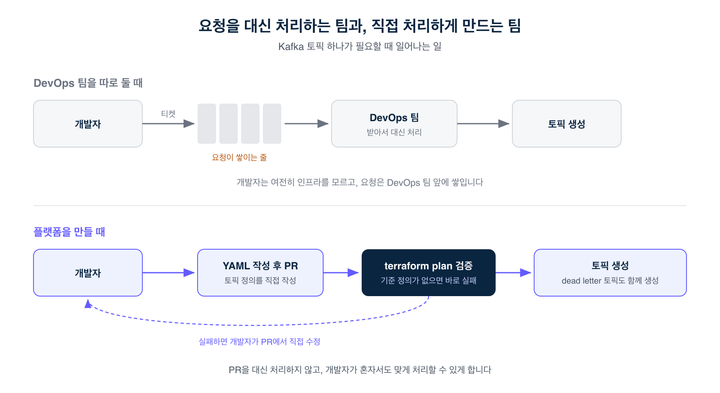
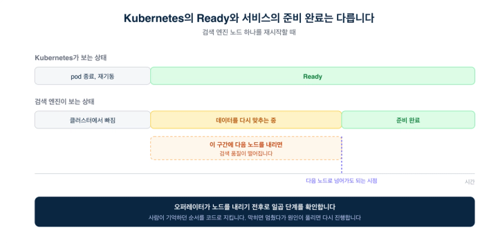
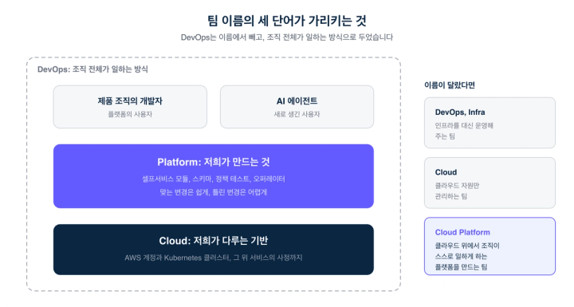

# 팀 이름을 DevOps가 아니라 Cloud Platform으로

> ## Excerpt
> 인프라를 대신 운영하는 팀이 아니라, 누구나 직접 다룰 수 있게 만드는 팀

---
기술 블로그2026\. 10. 22

채용 공고를 둘러보면 인프라를 다루는 팀의 이름은 대개 셋 중 하나입니다. DevOps, Infra, Cloud. 플렉스팀에서 이 일을 하는 팀의 이름은 Cloud Platform입니다. 처음 듣는 분들은 거의 같은 말 아니냐고 묻습니다. 저희에게는 꽤 다른 말입니다.

그 차이는 이름에 무엇을 넣고 무엇을 뺐는지에서 드러납니다. 그래서 이 글은 저희 팀 이름에서 뺀 단어부터 시작합니다.

___

## DevOps가 아닌 이유

DevOps는 원래 개발과 운영을 나누지 말자는 말입니다. 그런데 DevOps라는 이름의 팀을 따로 두면 이런 일이 생기곤 합니다. 개발자가 코드를 넘기면 DevOps 팀이 받아서 배포하고, 인프라에 필요한 것이 생기면 개발자는 티켓을 씁니다. 개발자는 여전히 인프라를 모르고, DevOps 팀은 쌓이는 티켓 앞에서 병목이 됩니다. 개발과 운영을 나누지 말자는 이름의 팀이, 결국 운영을 따로 떼어 맡게 됩니다.

몇 년 전부터 'DevOps is Dead'라는 말이 들립니다. 저희는 이 말을 DevOps의 종말이 아니라, DevOps라는 이름만 붙은 별도 조직의 종말로 읽습니다. 그래서 플렉스팀에는 DevOps Engineer가 없습니다. DevOps는 한 팀의 직무가 아니라 개발 조직 전체가 일하는 방식이어야 한다고 보기 때문입니다.

저희 팀에는 오래된 원칙이 하나 있습니다. 같은 요청이 두 번 오면, 그다음부터는 요청한 사람이 직접 할 수 있게 도구를 만든다는 것입니다.

Kafka 토픽이 좋은 예입니다. 토픽이 필요한 개발자는 인프라 팀에 티켓을 쓰지 않습니다. YAML 파일에 토픽 정의를 적고 PR을 올립니다. Terraform 모듈이 그 파일을 읽어 토픽을 만듭니다. 실패 처리용 dead letter 토픽은 한 줄만 선언하면 이름 규칙에 맞춰 함께 만들어집니다. 환경별 설정을 덮어쓰는 파일에 기준 정의가 없는 토픽이 있으면 `terraform plan`이 바로 실패해서, 개발자가 PR 안에서 직접 고칩니다.

저희 일은 그 PR을 대신 처리하는 것이 아니라, 개발자가 혼자서도 맞게 처리할 수 있는 장치를 만드는 것입니다.

___

## Cloud만이 아닌 이유

클라우드를 다루는 팀이니 Cloud면 충분하지 않을까요. 저희는 클라우드 자원을 관리하는 데서 멈추고 싶지 않았습니다.

AWS 계정과 Kubernetes 클러스터를 잘 관리하는 것은 기본입니다. 하지만 그 위에서 서비스를 운영하려면 클라우드가 알려 주지 않는 지식이 필요합니다. 검색 엔진 노드를 재시작하는 일이 좋은 예입니다. Kubernetes는 pod가 Ready라고 알려 주지만, 검색 엔진 입장에서는 아직 데이터를 다시 맞추는 중이라 준비가 안 됐을 수 있습니다. 이 사실을 모르고 다음 노드를 내리면 검색 품질이 떨어집니다.

예전에는 이런 지식을 사람이 기억해서 순서를 지켰습니다. 지금은 저희가 만든 오퍼레이터가 노드를 내리기 전후에 일곱 단계에 걸쳐 안전한지 확인합니다. 막히면 멈춰서 사람을 기다리고, 원인이 풀리면 다시 진행합니다. 노드 정리 설정에도 비슷한 지식이 들어 있습니다. HR 서비스는 출근과 퇴근 시간에 근태 기록이 몰립니다. 그래서 그 시간대에는 노드를 정리하지 않는다는 시간표가 설정 안에 있습니다.

클라우드를 아는 것과 그 위에서 운영되는 서비스를 아는 것은 다른 일입니다. 저희는 둘 다 하려고 합니다.

___

## Platform인 이유

남은 단어는 Platform입니다. 저희에게 플랫폼은 제품이고, 사용자는 제품 조직의 개발자입니다.

제품이라고 부르는 데는 이유가 있습니다. 제품은 사용자가 설명서 없이도 올바르게 쓸 수 있어야 합니다. 플랫폼도 마찬가지입니다. 표준을 문서로 강제하기보다, 좋은 기본값을 주고 잘못된 입력은 미리 걸러서 사용자가 적은 노력으로 맞는 선택을 하게 해야 합니다. 앞에서 본 Kafka 토픽 모듈이 그런 예입니다.

요즘 이 플랫폼에는 AI 에이전트라는 새 사용자가 생겼습니다. 8월 말부터 두 달이 채 안 되는 동안 저희 인프라 저장소에 올라온 커밋 287건 가운데 82건을 봇 계정이 올렸습니다. 운영 에이전트가 필요보다 큰 DB 인스턴스를 줄이자고 제안하고, 오래된 버킷 수명 주기 규칙을 정리하는 PR을 엽니다.

코드를 쓰는 비용이 거의 0이 되면서, 플랫폼이 해야 할 일도 바뀌었습니다. 이제 중요한 것은 변경을 쉽게 만드는 일보다 그 변경이 맞는지 확인할 수 있게 하는 일입니다. 그래서 저희는 인프라를 코드로 적는 데서 멈추지 않고, 변경이 맞는지 기계가 확인할 수 있는 소프트웨어로 만듭니다. 에이전트에게 줄 도구와 권한을 정하는 선언 파일에는 스키마가 붙어 있습니다. AI 기능의 trace에서 사용자 입력을 가리는 규칙이 제대로 동작하는지는, 운영 설정을 그대로 읽는 테스트가 CI에서 매번 확인합니다. 사람이든 에이전트든 같은 장치를 통과합니다.

___

## 그래서 Cloud Platform입니다

세 단어를 다시 이어 보면 이렇습니다.

DevOps는 저희 팀의 이름이 아니라 조직 전체가 일하는 방식입니다. 그래서 이름에서 뺐습니다. 저희가 할 일은 그 방식이 한 팀의 일로 줄어들지 않게, 누구나 인프라를 직접 다룰 수 있게 하는 것입니다.

Cloud는 저희가 다루는 기반입니다. 클라우드를 잘 아는 것은 출발점일 뿐이고, 그 위에서 운영되는 서비스의 사정까지 알아야 기반을 제대로 관리할 수 있습니다.

Platform은 저희가 만드는 것입니다. 클라우드 위에서 다른 사람들이 일할 수 있게 하는 제품입니다. 좋은 플랫폼은 사용자가 누구든 맞는 변경은 쉽게, 틀린 변경은 어렵게 만듭니다. 사용자가 개발자에서 에이전트로 넓어진 지금도 이 정의는 그대로이고, 오히려 더 중요해졌습니다.

인프라를 대신 운영해 주는 팀이었다면 DevOps나 Infra라는 이름이 맞았을 것입니다. 클라우드 자원만 관리하는 팀이었다면 Cloud로 충분했을 것입니다. 저희는 클라우드 위에서, 조직 전체가 스스로 일할 수 있는 플랫폼을 만드는 팀입니다. 그래서 이름이 Cloud Platform입니다.

___

## 함께할 동료를 찾습니다.

이름은 정했지만, 이름에 담은 방향대로 일하는 것은 매일의 일입니다. 플렉스팀의 백여 개 서비스와 데이터 플랫폼이 이 기반 위에서 돌아가고, 그 위로 급여·근태·인사 발령처럼 틀리면 안 되는 데이터가 흐릅니다. 다루는 범위가 넓은 만큼, 아직 답을 찾고 있는 질문도 있습니다.

누구나 인프라를 직접 다루게 하려면 제품 조직과 책임을 어디서 나누고 어디서 함께 일해야 할지. 좋은 기본값으로 맞는 선택을 쉽게 만들면서, 표준이 늘어 느려지는 것은 어떻게 막을지. 에이전트가 변경을 제안하고 PR을 여는 지금, 플랫폼이 확인해야 할 범위는 어디까지 넓어져야 할지. 저희가 요즘 붙들고 있는 질문들입니다.

요청을 대신 처리하기보다 요청한 사람이 직접 할 수 있는 도구를 만드는 데 끌리는 분, 클라우드 너머 서비스의 사정까지 알고 싶은 분, 사람이든 에이전트든 맞는 변경은 쉽게, 틀린 변경은 어렵게 만드는 장치에 관심 있는 분이라면 이 질문들을 저희와 함께 풀어 갈 수 있을 것입니다.

[

🚀플렉스팀 채용페이지 바로가기

](https://flex.careers.team/)[

☕flex Private Talk 신청하기

](https://forms.gle/p1gBm8kpeRgw7QgVA)
