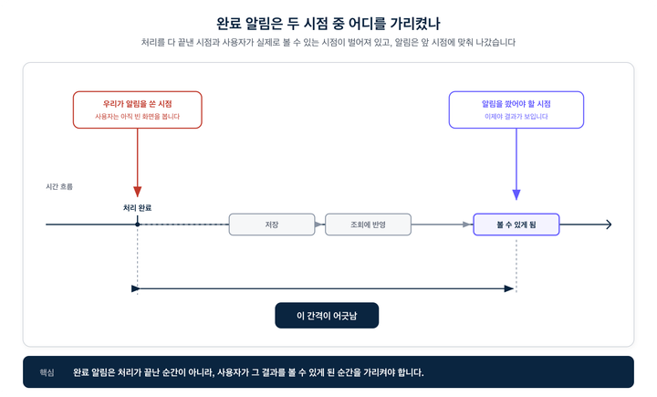
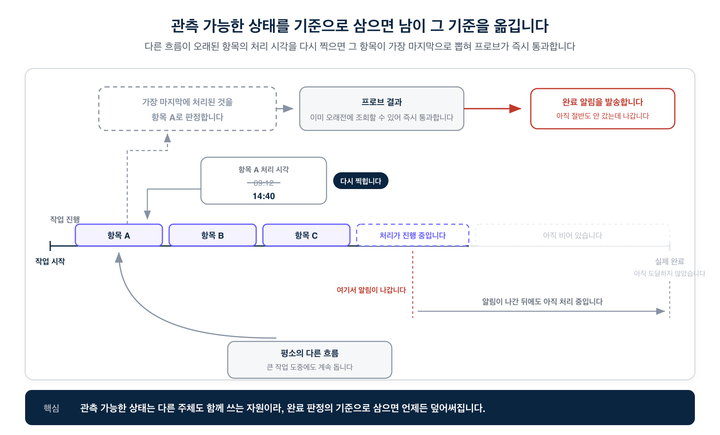
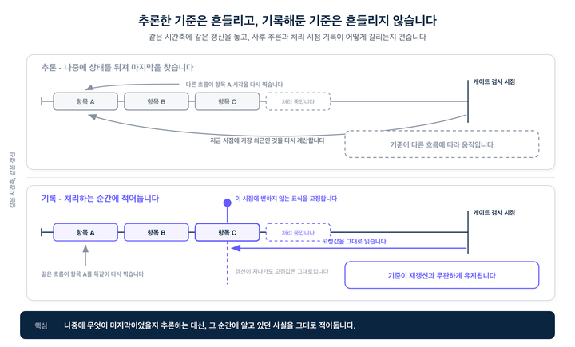
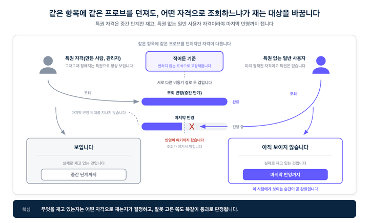

# 다 됐습니다 알림, 대체 언제 보내야 맞나

> ## Excerpt
> 완료를 나중에 관측하지 않고, 처리하는 순간에 기록하기로 한 이유

---
기술 블로그2026\. 9. 22

## 완료 알림이 실제보다 먼저 나갔다

버튼 한 번 누르면 시작되는데 끝나기까지는 한참 걸리는 작업이 있습니다. 쌓인 걸 한 번에 몰아서 처리하거나, 대량으로 뭔가를 찍어내는 배치성 작업이요. 시작한 사람은 화면 앞에 앉아 기다리지 않죠. 걸어두고 딴 일 하러 가고, 다 끝나면 저희가 "이제 다 됐습니다" 하고 알림을 보냅니다.

어느 날 그 알림이 실제보다 먼저 나간 적이 있습니다. 작업은 절반도 안 갔는데 완료 알림이 나갔고, 그걸 받고 결과 보러 온 사람은 텅 빈 화면을 봤습니다. 웃긴 건, 그 알림을 내보낸 완료 판정이 그 순간 아무 오류 없이 ‘정상’으로 끝났다는 점이에요.

이 글은 그 알림 하나를 제대로 쏘려고 저희가 겪은 삽질의 기록입니다. 비슷하게 ‘다 됐다는 걸 어떻게 알지’로 고민 중인 분들에게, 저희가 이렇게 풀어본 경험을 전해드려요.

미리 말씀드리면, 처음엔 이게 별거 아닌 줄 알았습니다. ‘다 됐다’를 판정하는 게 이렇게 두 번이나 뒤집힐 문제일 거라고는 생각 못 했습니다.

___

## 속도 문제가 아니었다

처음엔 처리가 느려서 그런 줄 알았습니다. 아니었습니다.

두 개의 시점이 있었습니다. ‘작업을 다 처리한 시점’과 ‘사용자가 그 결과를 실제로 볼 수 있는 시점’. 이 둘이 같지 않았어요. 저희 알림은 앞쪽에 맞춰져 있었는데, 정작 사용자한테 필요한 건 뒤쪽이었습니다.

이 둘이 벌어져 있으면, 처리를 아무리 빨리 끝내도 알림은 계속 이르게 나갑니다. 빨라진다고 붙는 문제가 아니라는 거죠.

그래서 저희가 오래 붙들고 있던 질문은 "어떻게 빨리 끝내지"가 아니라 “이 알림을 언제 쏘지"였습니다.

___

## "건수 세면 되잖아요"

이 얘기를 하면 다들 처음에 이렇게 말합니다. 처리할 게 1만 건이고 1만 건이 다 처리됐으면 끝난 거 아니냐고.

저희도 그렇게 시작했습니다. 그런데 저희 알림이 하는 말은 "다 처리했습니다"가 아니라 "이제 확인하실 수 있습니다"더라고요. 이 둘 사이에는 단계가 몇 겹 더 있었는데요.

처리한 걸 저장하고, 저장한 걸 조회되는 자리에 반영하고, 그걸 누가 볼 수 있는지까지 정해져야 비로소 사용자 눈에 들어옵니다. 문제는 이 뒷단계들이 저마다 다른 흐름으로 뒤늦게 따라온다는 거였죠.

그러니 건수를 아무리 꼼꼼하게 세어봐야, 그건 앞쪽 시점을 잰 것에 불과했습니다. 정작 사용자가 볼 수 있는 뒤쪽 시점은 재지 못했던 거죠.

___

## "그럼 안 어긋나게 만들면 되잖아요"

다음으로 나오는 말은 이겁니다. 앞뒤가 벌어지는 게 문제라면, 처리랑 반영을 한 덩어리로 묶어서 동시에 끝내버리면 되지 않냐고. 그러면 따로 잴 것도 없지 않냐는 거죠.

맞는 말이고, 저희도 없앨 수 있는 데는 최대한 없앴습니다. 근데 이 어긋남이 이 작업만의 사정이 아니었어요. 저장하는 일, 조회되게 반영하는 일, 누가 볼지 정하는 일은 원래 성격이 다릅니다. 처리량 뽑으려고 일부러 비동기로 떼어놓은 구조여서, 이걸 억지로 한 덩어리의 동기로 묶으면 대량 처리 속도가 통째로 주저앉게 됩니다.

결국 아무리 잘 설계해도 못 없애는 구간이 남는데요. 저장은 끝났는데 아직 조회에는 안 걸리는 구간, 결과는 다 만들어졌는데 사용자한테만 아직 안 보이는 구간처럼요.

이 ‘남는 어긋남’이 이 글의 출발점입니다. 어차피 못 없앨 거면, 완료 알림은 ‘처리 끝난 순간’ 이 아니라 ‘사용자가 결과를 볼 수 있게 된 순간’을 가리켜야 하니까요. 뒤에 나올 얘기는 전부 이 남는 구간 하나를 어떻게든 정확히 재보려는 시도입니다.

___

## 그래서 세지 말고, 직접 조회해보기로

방향을 틀었습니다. 세는 걸 그만두고, 실제로 조회를 해보기로 했습니다.

결과물 하나를 골라서, 사용자가 진짜로 보게 될 그 조회 경로에 질의를 딱 던져봅니다. 돌아오면 통과, 안 돌아오면 아직 멀었다는 뜻이고요. 카운터가 아니라 프로브(probe)인 거죠.

별거 아닌 전환 같지만, 이 선택이 뒤이어 나올 모든 결정을 끌고 다녔습니다. 직접 조회를 해보려면 두 개를 골라야 하거든요. 무엇을 조회할지, 그리고 누구 자격으로 조회할지 였어요.

___

## 마지막이 자꾸 바뀌었다

‘무엇을 조회할지’에 대한 첫 답은 뻔했습니다. 가장 마지막에 처리된 놈을 뽑아서 그걸 프로브 대상으로 삼자는 거였죠. 순서대로 처리됐다면 맨 끝에 들어간 게 조회되는 순간, 그 앞엣것들은 이미 다 조회됐을 테니까요. 논리는 지금 봐도 틀리지 않았고, 이걸로 끝인 줄 알았습니다.

문제는 이 작업이 오래 걸린다는 점, 그리고 그동안 시스템이 이 작업만 하고 있는게 아니라는 점이었어요. 이 큰 배치가 도는 몇 시간 내내, 평소 돌던 다른 흐름들은 제 주기대로 계속 돌고 있었죠.

그러다 사고가 납니다. 몇 시간 전에 이미 처리가 끝난 오래된 항목을, 그 다른 흐름 중 하나가 다시 건드립니다. 그러면서 ‘마지막으로 처리된 시각’을 지금 시각으로 다시 찍어버려요.

이제 그 오래된 항목이 ‘가장 마지막’으로 뽑힙니다. 근데 그놈은 진작에 조회도 되고 뒷단계도 다 끝난 상태잖아요. 프로브 던지면 당연히 즉시 통과해버립니다. 정작 큰 배치는 절반도 안 갔는데, 완료 게이트가 열리고 알림이 나가버린 거죠. 처음에 겪은 그 조기 알림이 딱 이 문제였습니다.

한참 뒤에야 깨달았는데, 쿼리가 틀린 게 아니었어요. ‘마지막으로 처리된 시각’ 처럼 남이 언제든 덮어쓸 수 있는 값을 기준으로 삼은 것 자체가 틀린 거였습니다. 그 값은 저희만 쓰는 게 아니라 여러 흐름이 같이 쓰는 공유 자원이고, 걔들은 저희 배치 사정 따위 모르고 언제든 그 위에 자기 시각을 덮어씁니다. 나중에 그걸 뒤져서 "뭐가 마지막이었지?"를 추론하려는 순간, 그 추론은 얼마든지 오염될 수 있는 셈이었죠.

그래서 이 방식은 고쳐 쓰지 않고 그냥 버렸습니다.

___

## 추론하지 말고, 그때 박아두자

대안은 시시할 만큼 단순했습니다. 나중에 상태를 뒤져서 추론하지 말고, 처리하던 그 순간에 알고 있던 사실을 그냥 그 자리에 박아두는 겁니다.

배치를 도는 쪽은 자기가 방금 마지막으로 뭘 처리했는지 그 순간만큼은 정확히 압니다. 그러니 그 결과물의 안 변하는 식별값을 그 자리에서 딱 고정해둡니다. 이후에 그 항목이 열 번을 다시 갱신되든, ‘처리 시각’이 몇 번을 다시 찍히든, 박아둔 값은 안 흔들립니다. 완료 게이트는 상태를 새로 계산할 필요 없이 이 고정값만 읽으면 되고요.

추론이랑 기록의 차이가 여기서 갈립니다. 추론은 남이 언제든 건드릴 수 있는 값 위에 서 있지만, 기록은 아무도 안 건드리는 자리에 딱 박혀 있습니다. 한 번 잘못 쏘면 무를 수 없는 알림이기에, 기준은 반드시 후자여야 했습니다.

여기까지 오고 나니, 이제 정말 됐다 싶었습니다.

___

## 조금 더 어려운 문제 — 누구 눈으로 볼 것인가

하지만 아니었습니다. 기준을 고쳐도 프로브는 여전히 엉뚱한 걸 잴 수 있었어요. 사실 저희가 이 작업에서 가장 오래 붙들고, 가장 늦게 깨달은 게 바로 이 지점이었습니다.

프로브는 "이거 조회되냐?"를 묻습니다. 그런데 조회라는 게 항상 ‘누군가의 자격으로’ 일어나요. 이 자격을 잘못 고르면, 검사는 멀쩡히 통과하는데 정작 엉뚱한 걸 재고 있게 됩니다.

시스템엔 대개 힘센 자격이 하나쯤 존재합니다. 그 결과물을 만든 장본인이라든가, 관리자라든가. 뒷단계가 하나도 안 끝났어도 이미 그 항목을 볼 수 있는 특권 자격이요. 하필 프로브를 이런 자격으로 던지면, 마지막 반영이 하나도 안 됐어도 결과물이 형태만 갖춰지면 바로 통과해버립니다. 완료를 재려던 건데, 실제론 중간 단계 하나만 재고 있는 셈이죠.

그래서 검사에 쓸 자격을 특권 없는 ‘일반 사용자’로 바꿨습니다. 그 결과물을 볼 권한은 정당하게 갖고 있지만, 아무런 특권도 없는 사람으로요. 이 사람은 지름길이 없으니 뒷단계가 진짜로 다 끝나야만 비로소 그 항목을 볼 수 있습니다. 뒤집어 말하면, 이 사람 눈에 결과물이 보이기 시작하는 순간이 곧 ‘정당한 일반 사용자가 이제 이걸 쓸 수 있게 된 순간’입니다. 저희가 알림으로 약속하려던 게 정확히 그 시점이었습니다.

___

## 특권 경로를 하나씩 뺀다

그럼 그 ‘특권 없는 일반 사용자’를 실제로 어떻게 골라내느냐가 남습니다.

누가 그 결과물을 볼 자격이 있는지 쭉 읽되, 저희가 믿는 건 미리 정해진 자격뿐입니다. 그 항목의 주인이 누구든 상관없이 사전에 부여된 자격은, 뒷단계가 다 끝나야 비로소 그 항목을 보게 되거든요.

반대로 ‘만든 사람’, ‘담당자’처럼 항목마다 그때그때 붙는 자격은 대놓고 뺍니다. 이것들이 결국 지름길이라, 안 빼놓으면 애써 고른 검사 자격이 슬그머니 다시 특권으로 돌아가버려요. 검사 자격을 고르는 일의 절반은, 사실 이렇게 지름길을 하나씩 막아세우는 작업이었습니다.

결국 지금 뭘 재고 있느냐는, '무엇을' 검사하느냐가 아니라 **'누구의 자격으로'** 검사하느냐가 결정합니다. 같은 프로브, 같은 항목이라도 자격 하나 바꾸면 재는 대상이 중간 단계에서 최종 단계로 훅 옮겨갑니다. 무서운 건 잘못 고른 쪽도 똑같이 '통과'로 나온다는 점입니다. 그래서 대상이 바뀐 줄도 모르고 넘어가기 쉽습니다.

___

## 대신 포기한 것 세 가지

이렇게 구조를 잡으면서 저희가 감수한 것도 세 가지 있습니다.

첫째, 기준을 하나만 두지 않고 여러 개 적어둡니다. 이론대로라면 마지막에 처리한 것 하나로 충분하지만, 처리 도중에 그 기록이 유실되는 일이 실제로 있었습니다. 기준이 하나뿐이면 그게 사라지는 순간 게이트는 열릴 근거를 잃고 영영 닫혀 있게 되죠. 그래서 마지막 몇 개를 함께 적어두고, 그중 하나라도 조회되면 완료로 판단합니다. ‘정확히 마지막 하나’라는 이상을 조금 양보하고, 기준 하나가 사라져도 무너지지 않는 쪽을 택한 겁니다.

둘째, 특권 없는 일반 사용자를 못 찾으면 특권 자격으로 되돌아갑니다. 볼 자격이 지름길로만 주어진 경우도 있고, 저희가 아직 해석 못 하는 형태로만 있는 경우도 있어요. 그럴 땐 특권 가시성을 차선책으로 씁니다. 앞에서 그렇게 조심하던 조기 알림 위험을 알고도 받는 건데, 아무 신호 없이 무작정 붙들고 있는 것보단 낫다고 봤습니다. 다만 이런 결정은 ‘이건 부정확한 신호’라고 코드랑 문서에 못 박아두는 한에서만 정직하다고 생각합니다.

셋째, 게이트가 영영 안 열릴 때를 대비한 강제 발송이 있습니다. 정해진 시간을 넘겨도 통과 못 하면 그냥 알림을 보냅니다. 알림이 조금 이르게 나가는 것보다, 게이트가 알림을 영원히 붙들고 있는 게 훨씬 나쁘니까요. 비슷한 판단이 한 군데 더 있는데, 적어둔 기준이 아예 없거나 프로브 대상을 못 찾아서 애초에 검사를 걸 수 없는 경우엔 그냥 건너뛰고 바로 보냅니다. 판정할 수 없으면 붙들지 않는다는 원칙입니다. 판정도 못 하면서 무한정 붙들고 있는 건 신중한 게 아니라 그냥 고장난 거니까요.

___

## 무엇이 나아졌나

결과적으로, 사람이 대시보드를 들여다보며 "이 정도면 됐나?" 판단하는 과정이 사라졌습니다.

완료로 통과했든, 시간 초과가 났든, 프로브 대상이 사라졌든, 세 경우 모두 코드가 알아서 종결하고 기록을 남깁니다. 운영자가 화면을 보며 손으로 "보낼까 말까"를 고르지 않게 된 것이죠.

이게 가능해진 건 앞서 내린 두 결정 덕분입니다. 기준이 변하지 않으니 언제 다시 계산해도 같은 답이 나오고, 검사 자격이 명확하니 '통과했다'는 말의 의미가 흐려지지 않습니다. 둘 중 하나만 흔들렸어도 결국 사람의 판단을 중간에 끼워 넣어야 했을 겁니다. 자동 종결은 그 자체를 목표로 삼아서 얻었다기보다, 판정의 기준을 제대로 정의하니까 자연스럽게 따라온 결과에 가까웠습니다.

___

## 결국 저희가 깨달은 것

맨 처음, 텅 빈 화면을 봤던 그 사람으로 돌아가 볼게요.

그때 게이트가 절반 만에 열린 건, ‘가장 마지막에 처리된 것’을 그때그때 다시 계산해서 물었고 다른 흐름이 그 답을 진작 끝난 항목으로 바꿔놨기 때문입니다. 지금은 처리하던 순간에 박아둔 값을 읽고, 특권 없이 모든 단계를 끝까지 기다려야 하는 자격으로 그 항목을 조회합니다. 그 조회가 처음으로 성공하는 순간이, "이제 진짜 쓰실 수 있습니다"라고 말할 수 있는 순간이고요. 그래서 이제, 같은 알림을 받고 들어온 사람은 텅 빈 화면 대신 자기 결과물을 봅니다.

정리하자면 저희가 얻은 건 두 문장입니다.

-   완료는 나중에 화면을 들여다보며 관측하는 상태가 아니라, 그 일을 한 순간에 적어두는 사실이더라.
-   그리고 완료 알림은 처리가 끝난 순간이 아니라, 사용자가 그 결과를 볼 수 있게 된 순간을 가리켜야 하더라.

배치 완료를 판정하는 다른 방법들이나, 여기서 안 다룬 유실 복구 얘기는 또 기회가 되면 풀어보겠습니다. 혹시 비슷한 문제로 고민 중이시거나 "우리는 이렇게 풀었다" 하는 경험이 있다면 편하게 이야기 나눠주세요. 감사합니다.

___

[

🚀플렉스팀 채용페이지 바로가기

](https://flex.careers.team/)[

☕flex Private Talk 신청하기

](https://forms.gle/p1gBm8kpeRgw7QgVA)
