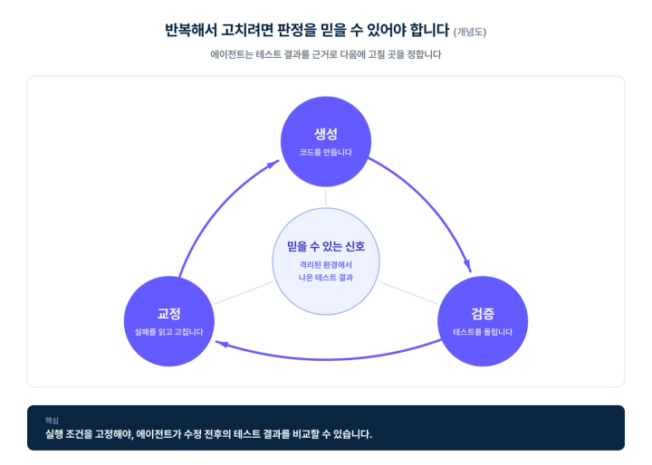
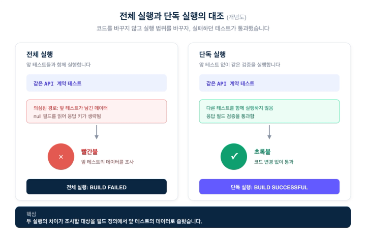
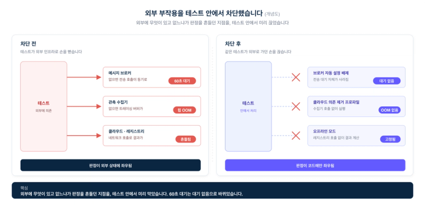
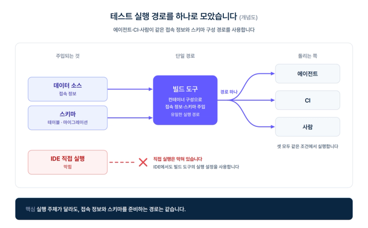
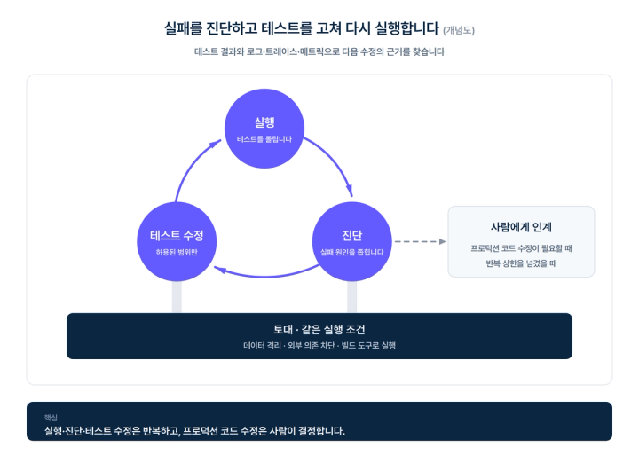
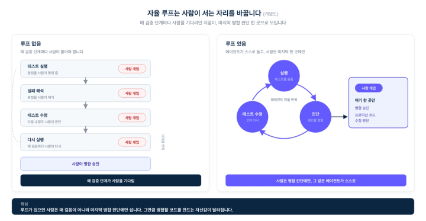

# 격리 안 된 테스트의 초록불은, 에이전트가 믿을 수 없습니다

> ## Excerpt
> AI 에이전트가 스스로 검증하고 수정하려면, 테스트 결과부터 신뢰할 수 있어야 합니다

---
기술 블로그2026\. 9. 8

## 테스트를 짤 시간이 없던 시대는 끝났다

예전에는 테스트를 못 짜는 이유가 대개 시간이었습니다. 기능을 먼저 붙이고, 테스트는 여유가 생기면 쓰기로 미뤄 두다가 결국 못 쓰는 일이 흔했죠. 그런데 이제는 에이전트가 그 테스트를 대신 써 줍니다. 관건이 "얼마나 많이 짜느냐"에서 다른 데로 옮겨 갔습니다. 어떤 테스트가 개발을 가속하는 루프를 여느냐입니다.

저희는 같은 코드가 전체 테스트에서는 실패하고 단독 실행에서는 통과하는 장면을 봤습니다. 에이전트가 코드를 만들고, 테스트를 돌리고, 실패를 읽어 다시 고치는 반복을 self-feedback loop라 합니다. 생성과 검증을 반복하도록 에이전트 스스로를 학습시킨 ReVeal(arXiv:2506.11442, 2025)은 세 턴의 학습만으로 추론 시점에는 20턴 넘게 코드를 진화시켰습니다.



에이전트가 다음에 무엇을 고칠지는 이 초록불과 빨간불에 달려 있습니다. 반복해서 고치기 전에, 그 판정부터 믿을 수 있어야 합니다.

___

## 전체 실행은 실패하고, 단독 실행은 통과했습니다

에이전트에게 통합 테스트를 통째로 돌려 보라고 시켰습니다. 얼마 지나지 않아 한 API 계약 테스트가 빨갛게 떴습니다(BUILD FAILED). 에이전트는 처음엔 "응답에 특정 필드가 없어서 실패했다"고 진단했습니다. 그런데 코드를 확인하니 그 필드는 멀쩡히 있었습니다. 에이전트는 첫 진단을 거두고, 제품 결함과 테스트 오염을 가르기 위해 실행 조건을 바꿨습니다.

그 다음이 결정적이었습니다. 에이전트가 그 테스트만 따로 떼어 단독으로 돌리자 통과했습니다(BUILD SUCCESSFUL). 에이전트의 판정은 이랬습니다. "결정적이다. 격리하면 통과하고 전체에서는 실패한다. 그러니 제품 결함이 아니라 테스트 간 상호 오염이다." 정황이 가리킨 원인은 이랬습니다. 앞서 돈 다른 통합 테스트가 특정 필드가 비어 있는(null) 레코드를 여러 건 만들었는데, 트랜잭션 롤백도 컨텍스트 초기화도 없어 그 레코드들이 커밋된 채 남았을 것입니다. 값이 null인 필드는 직렬화 과정에서 응답 키가 생략되므로, 그 키가 있어야 한다고 믿은 뒤 테스트가 검증에 실패한 것으로 보였습니다. 어느 레코드가 정확히 원인이었는지 데이터베이스 행 단위로 못 박는 실험까지 간 것은 아닙니다. 격리 실행 결과와 null 필드의 직렬화 방식이 테스트 간 오염을 지목한 근거였습니다.

코드 확인만으로는 응답에서 왜 키가 빠졌는지 설명되지 않았습니다. 단독 실행과 전체 실행을 대조하자, 조사할 대상이 필드 정의에서 앞 테스트가 남긴 데이터로 좁혀졌습니다. 에이전트가 첫 진단을 고친 근거는 이 실행 결과의 차이였습니다.

익숙한 개발자는 이런 실패를 보면 테스트 순서부터 의심하고 단독으로 다시 돌려 봅니다. 에이전트도 그 대조를 할 수 있어야 합니다. 실패를 곧바로 제품 결함으로 받아들이면, 원인이었던 실행 조건은 둔 채 멀쩡한 코드를 고치게 됩니다.



실행을 반복해도 개선으로 이어지지 않는 다른 사례로 gutter가 있습니다. 실패하던 단정을 삭제해 "해결"했다고 보고하거나, 같은 명령을 세 번 연달아 실패하고도 진전 없이 되풀이하는 패턴입니다. Cursor의 Ralph 플러그인은 이런 패턴을 탐지해 gutter라 부릅니다. 저희 사건의 조사 대상은 테스트 간 데이터 오염이었고, gutter에서는 에이전트가 검증문을 지우거나 같은 실패를 반복했습니다. 원인은 달라도, 실행 결과를 올바른 수정에 쓰지 못한다는 문제가 남습니다.

에이전트는 단독 실행과의 대조로 진단을 바로잡았습니다. 이 대조 없이 빨간불만 보고 수정을 맡길 수는 없습니다. 자동 교정의 전제는 테스트 결과를 믿고 수정할 곳을 고를 수 있다는 데 있습니다.

___

## 코드 밖에서 판정을 흔드는 세 가지 변수

저희 코드베이스에서는 코드가 그대로인데도 테스트의 성패를 바꾸는 조건이 셋 있었습니다. 모두 실제 테스트 실행에서 확인한 문제입니다.

첫째는 테스트 간 상태 오염입니다. 앞 테스트가 남긴 데이터베이스 상태를 뒤 테스트가 읽어 실패합니다. 앞서 본 API 계약 테스트에서 의심한 원인도 이것이었습니다. 같은 컨텍스트를 공유하는 테스트들이 서로의 데이터를 읽으면, 실행 순서에 따라 판정이 달라집니다.

둘째는 외부 인프라 편차입니다. 메시지 브로커가 없는 환경에서는 프로듀서의 전송 호출이 수십 초 동안 대기했습니다. 관측 데이터를 받아 갈 수집기가 없는 워커에서는 트레이싱 버퍼가 쌓여 힙을 소진하고 메모리 부족(OOM)으로 종료됐습니다. 로컬에는 있고 CI에는 없는, 혹은 그 반대인 인프라가 테스트의 성패를 좌우했습니다.

셋째는 실행 경로 편차입니다. IDE에서 직접 돌린 테스트와 빌드 도구로 돌린 테스트가 서로 다른 스키마와 환경 변수를 썼습니다. 같은 코드를 검증해도 실행 조건이 달랐으니, 한쪽에서 통과했다는 사실만으로 다른 쪽의 결과를 설명할 수 없었습니다.

이 차이는 결국 사람이 해석했습니다. "그거 원래 가끔 깨져", "IDE로 돌리면 되던데" 같은 말에는 실행 환경을 아는 사람의 경험이 들어 있습니다. 에이전트에게 테스트를 맡겨도 매번 그 설명이 필요하다면, 검증은 여전히 사람을 기다리는 일입니다.

___

## 테스트 환경과 실행 경로를 고정했습니다

저희는 로컬에서 테스트 데이터베이스를 자동으로 띄우고, 데이터와 외부 의존, 실행 경로를 통제했습니다. 에이전트와 CI와 사람이 같은 조건에서 수정 전후의 결과를 비교하게 하려는 조치였습니다.

먼저 통합 테스트용 데이터베이스 컨테이너는 하나만 띄우되, 모듈군마다 논리 데이터베이스를 나눴습니다. 특히 전 계정을 집계하는 쿼리를 가진 모듈에는 빌드 스크립트에서 전용 논리 데이터베이스를 지정했습니다. 다른 모듈의 테스트 데이터가 전역 집계에 섞이는 일을 막기 위해서입니다. 이 격리를 어떤 장치로 구성하는지는 이미 별도 글에서 다뤘으니, 여기서는 전제로만 삼습니다.

스키마 구성은 테스트가 시작되기 전에 끝냅니다. 테스트는 이미 만들어진 테이블에서 자기가 쓸 데이터만 비웁니다. 전용 데이터베이스를 쓰는 통합 테스트에서도 매 테스트 시작 시 대상 테이블을 비워, 앞 실행의 데이터를 읽지 않게 했습니다.

```
@BeforeEach
fun clearOrderData() {
    // 스키마 구성은 끝난 상태이며, 테스트가 쓸 데이터만 비웁니다.
    jdbc.jdbcTemplate.update("DELETE FROM order_lines")
    jdbc.jdbcTemplate.update("DELETE FROM orders")
}
```

데이터를 지우는 순서와 병렬 실행 범위도 맞춰야 합니다. 외래 키 제약에 따라 자식 테이블(`order_lines`)을 먼저, 부모 테이블(`orders`)을 나중에 지웁니다. 같은 데이터베이스의 같은 테이블을 쓰는 테스트끼리는 순차 실행해야 합니다. 병렬로 돌리면 한 테스트의 DELETE가 다른 테스트의 데이터까지 지우기 때문입니다. 논리 데이터베이스 분리는 다른 모듈과의 병렬 실행을, 매번 데이터를 비우는 처리는 같은 테이블을 쓰는 순차 실행을 격리합니다.

다음으로 외부 부작용을 차단했습니다. 저희 테스트에서는 브로커가 없을 때 프로듀서의 전송 호출이 max.block.ms 기본값인 60초 동안 동기로 대기했습니다(자체 실측). 테스트에서 메시지 브로커 관련 자동 설정을 배제해 이 대기를 없앴습니다. 클라우드 의존을 걷어낸 프로파일로 실행하고, 플러그인 통합 테스트에는 네트워크 없이 도는 오프라인 모드를 둬 레지스트리 호출 없이 결과를 계산하게 했습니다.



마지막으로 실행 경로를 하나로 모았습니다. 데이터 소스 접속 정보와 스키마는 빌드 도구의 컨테이너 구성 경로로만 주입합니다. IDE의 테스트 직접 실행은 막혀 있고, IDE에서도 빌드 도구의 실행 설정을 사용해야 합니다. 개발자가 익숙한 실행 방식을 바꿔야 하는 제약입니다. 그 대신 에이전트와 CI와 사람이 같은 경로에서 접속 정보와 스키마를 받아 검증합니다.



세 조건을 고정한 뒤에는 테스트가 실패할 때마다 실행 환경부터 맞춰 볼 필요가 없어졌습니다. 에이전트는 같은 조건에서 다시 실행하며 수정 전후의 결과를 비교할 수 있게 됐습니다.

___

## 실패를 진단하고 다시 실행합니다

검증 에이전트는 테스트 결과를 받아 실패를 유형별로 진단하고, 테스트를 수정한 뒤 다시 돌립니다. 설정에 둔 진단 가이드에 따라 정의되지 않은 스텝, 단정 실패, 런타임 예외, 스프링 컨텍스트의 빈 구성 오류, 메시지 브로커 타임아웃을 구분합니다. API 계약 테스트에서도 단정 실패를 출발점으로 코드와 실행 조건을 확인해 테스트 오염까지 조사했습니다.

진단에는 통과 여부뿐 아니라 로그와 트레이스와 메트릭도 씁니다. 어느 단계가 느려졌는지, 어떤 예외가 어디서 났는지, 어느 호출이 무엇을 기다렸는지를 함께 읽습니다. "테스트가 실패했다"에서 "이 단계의 호출이 대기하다 이 예외로 끝났다"까지 원인을 좁히는 것입니다. 브로커가 없어 60초를 기다린 호출은 업무 로직이 느리다는 근거가 되지 않습니다. 외부 의존과 실행 조건을 고정해야 수정 전후의 지연과 예외를 같은 기준으로 비교할 수 있습니다.

구체적인 실행 피드백의 효과는 자연어를 정규식으로 옮기는 과제에서도 나타났습니다. 진단적 반례를 피드백으로 준 경우가 네 턴 안에 90%를 해결한 반면, 아무 피드백이 없으면 17%, 일반적인 자기교정은 27%, 실패 여부만 알려 준 경우는 23%에 그쳤습니다. 저희가 테스트 환경을 고정한 이유도, 에이전트가 실행 결과에서 다음 수정의 근거를 얻도록 하기 위해서였습니다.



반복 횟수와 중단 조건은 설정으로 정했습니다. 테스트 재실행과 재컴파일은 각각 세 번까지, 루프 전체는 다섯 번까지입니다. 정해진 횟수 안에 해결하지 못하면 사람에게 넘깁니다. "프로덕션 코드를 고쳐야 통과하는 상황이면 즉시 멈춰 사람에게 보고한다"는 규칙도 있습니다.

격리된 환경에서 한 자동 설정 테스트는 네 번의 실행 끝에 통과했습니다. 에이전트는 매번 테스트의 문제인지, 프로덕션 코드의 버그인지 구분했습니다. 관례를 벗어난 바인딩 애노테이션을 걷어냈고, 시계 빈이 빠져 있는 구성이 실제 애플리케이션에서는 안전하다는 것도 확인했습니다. 로그에는 실행이 네 차례 이어진 뒤 테스트가 통과한 결과가 남았습니다. 같은 조건에서 다시 돌릴 수 있었기에, 에이전트는 각 수정의 결과를 확인하며 다음으로 넘어갔습니다.

테스트의 실행과 진단, 허용된 범위의 수정은 에이전트가 반복합니다. 프로덕션 코드를 바꿀지에 대한 결정은 사람이 내립니다. 저희는 이 경계를 정해 두고, 그 안에서 반복하는 검증을 에이전트에게 맡겼습니다.

___

## 자동 검증 루프는 격리에서 시작합니다

격리에는 비용이 따릅니다. IDE의 테스트 직접 실행 대신 빌드 도구를 거쳐야 하고, 환경 변수와 스키마의 주입 설정을 유지해야 합니다. 논리 데이터베이스를 어떻게 나눌지, 어떤 외부 설정을 배제할지도 사람이 정해야 합니다.

그 비용으로 저희는 모듈 사이 데이터 격리와 테스트 시작 전 데이터 정리를 갖췄습니다. 전체 실행에서만 실패했던 API 계약 테스트를 조사하며 확인한 실행 조건의 차이를 통제한 것입니다. IDE와 CI의 실행 조건도 맞췄습니다. 에이전트는 매번 환경을 맞춰 줄 사람을 기다리지 않고, 같은 조건에서 테스트를 실행하고 수정 결과를 확인하게 됐습니다.

이 루프가 개발을 얼마나 앞당기는지는 업계 관측과도 맞물립니다. 복잡한 멀티파일 작업에서 자율 루프가 코드 생성을 5배에서 10배까지 앞당기면서, 병목이 코드 생성에서 사람의 검증으로 옮겨 갔다는 것입니다. 그 자율 루프도 2026년 중반까지는 병합 앞에서 멈춥니다. 사람의 승인을 거쳐야 프로덕션에 들어가죠. 저희 검증 에이전트는 그보다 앞선 자리에서 멈춥니다. 프로덕션 코드를 고쳐야 테스트가 통과하는 상황이면 손대지 않고 사람에게 보고합니다. 병합 승인과 코드 수정 판단은 서로 다른 결정입니다. 두 경우 모두 에이전트가 허용된 범위에서 반복 검증을 맡고, 그 경계에 닿으면 사람에게 넘깁니다.



테스트를 짤 시간이 없던 시대가 아니라, 어떤 테스트가 루프를 여는지가 관건인 시대입니다. 테스트 수를 늘려도 실행할 때마다 사람이 판정을 해석해야 한다면 그 반복을 에이전트에게 맡길 수 없습니다. 저희가 자동 검증 루프를 시작한 지점은 테스트 환경의 격리였습니다.

그래서 마지막으로 한 가지를 되묻고 싶습니다. 지금 여러분의 코드는 외부 환경 없이 로컬에서 그대로 실행되고 검증됩니까. 그렇지 않다면 에이전트는 여러분 없이 루프를 돌지 못합니다. 매번 사람이 붙어 환경을 맞춰 주고 초록불을 해석해 줘야 한다면, 에이전트는 그 사람을 기다리는 동안 멈춰 서 있습니다. 그 기다림은 그냥 흘러가지 않습니다. 같은 시간에 누군가의 에이전트는 사람을 기다리지 않고 스스로 돌고 있을 테니까요. 루프를 먼저 여는 쪽과 아직 사람을 기다리는 쪽의 거리는, 기다리는 그 시간만큼 벌어집니다.

___

[

🚀플렉스팀 채용페이지 바로가기

](https://flex.careers.team/)[

☕flex Private Talk 신청하기

](https://forms.gle/p1gBm8kpeRgw7QgVA)
