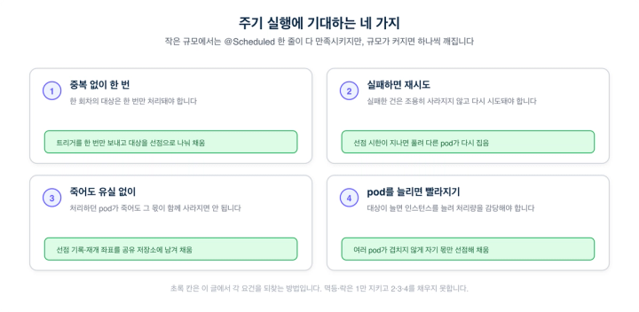
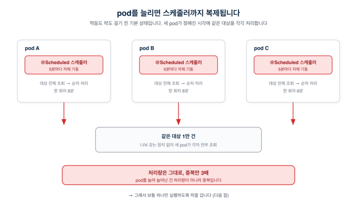
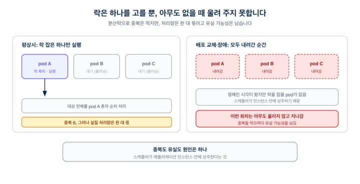
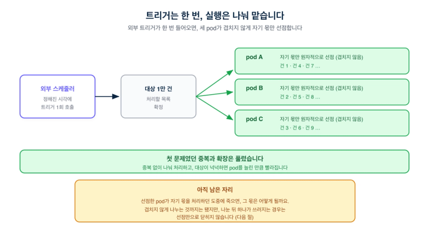
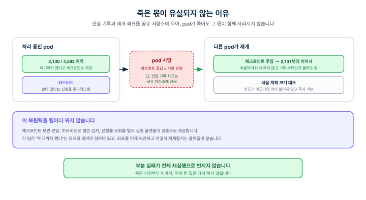
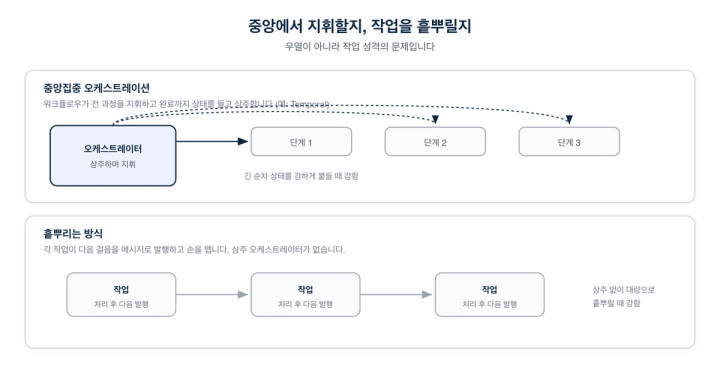

# @Scheduled 한 줄로 버티다, 트리거를 밖으로 꺼낸

> ## Excerpt
> 중복 실행과 유실을 넘어, 여러 pod가 작업을 나눠 갖는 스케줄 실행 구조로 전환하기까지

---
기술 블로그2026\. 8. 25

## Pod를 세 개로 늘렸는데, 같은 작업만 세 번 돌았습니다

5분마다 실행되는 배치가 있었는데, 대상이 만 건을 넘자 한 회차에 8분이 걸리기 시작했습니다. 이전 회차가 끝나기도 전에 다음 실행 시각이 돌아온 것입니다. 처리량이 부족한 줄 알고 pod를 세 개로 늘렸습니다. 배치는 빨라지지 않았습니다. 같은 작업만 세 번씩 실행됐습니다. 저희가 늘린 건 처리량이 아니라 중복이었습니다.

이 배치는 메서드 위에 `@Scheduled(cron = "0 */5 * * * *")` 한 줄로 시작한 것이었습니다. 수백 건이던 초기에는 나무랄 데가 없었고, 배포만 하면 스케줄도 함께 돌기 시작했습니다. 문제는 실행 로직이 아니라, 그 스케줄과 실행이 애플리케이션 인스턴스 하나에 함께 묶여 있었다는 데 있었습니다.

___

## 주기 실행에 기대하는 것

이 문제를 제대로 보려면, 주기 실행이 규모가 커진 뒤에도 지켜야 할 것이 무엇인지 먼저 정해 두는 편이 낫습니다. 저희가 배치에 기대한 건 네 가지였습니다.

-   **중복 없이 한 번.** 한 회차의 대상은 한 번만 처리돼야 합니다.
-   **실패하면 재시도.** 처리하다 실패한 건은 조용히 사라지지 않고 다시 시도돼야 합니다.
-   **죽어도 유실 없이.** 처리하던 pod가 죽어도 그 몫이 함께 사라지면 안 됩니다.
-   **Pod를 늘리면 빨라지기.** 대상이 늘면 인스턴스를 늘려 처리량을 감당할 수 있어야 합니다.

작은 규모에서는 `@Scheduled` 한 줄이 이 네 가지를 큰 고민 없이 만족시킵니다. 대상이 적으니 한 회차가 금방 끝나 중복도 유실도 눈에 띄지 않고, 재시도는 다음 회차가 어차피 다시 훑어 주며, Pod는 한두 대면 충분합니다. 규모가 커지면서 이 넷이 하나씩 깨지기 시작합니다. 아래는 그 넷을 되찾아 간 과정입니다.

___

## Pod와 함께 스케줄도 복제됐습니다

`@Scheduled`는 실행 시각과 실행 로직을 같은 애플리케이션 인스턴스에 묶습니다. "언제 도는가"와 "무엇을 하는가"가 한곳에 있고, 애플리케이션이 뜨면 스케줄러 스레드도 함께 떠서 주기적으로 그 메서드를 호출합니다.

문제는 애플리케이션을 여러 Pod로 띄우는 순간 드러납니다. Pod를 늘리면 실행자만 복제되는 게 아니라 그 안의 스케줄러까지 통째로 복제됩니다. 정해진 시각이 되면 세 Pod가 같은 조건으로 대상 전체를 각각 조회해 처리합니다. 세 Pod가 일을 나눠 가진 게 아니라, 같은 전체 작업을 세 번 반복한 셈입니다. 나눠 갖는 장치가 없으니 처리량은 그대로고 중복만 Pod 수만큼 늘어납니다.

저희도 이 중복을 겪었고, 처음에는 멱등 처리로 막았습니다. 같은 회차의 결과가 두 번 남지 않게 한 것입니다. 로그는 조용해졌고 데이터 중복도 사라졌습니다. 사라진 건 결과의 중복뿐이었습니다. 세 Pod는 여전히 대상 전체를 각각 처리했고, 그중 두 Pod가 한 일은 버려졌습니다. 자원은 세 배로 쓰고 처리량은 한 대 몫에 머물렀습니다. 데이터 중복을 막는 것과 작업을 나눠 갖는 것은 다른 문제였습니다.

___

## 락으로 하나만 돌리면, 그 하나가 사라질 때 멈춥니다

멱등이 결과의 중복을 지웠다면, 실행의 중복 자체를 막는 더 흔한 방법이 락입니다. 여러 Pod가 동시에 스케줄러를 돌리려 할 때, 분산락(예: Redis)이나 데이터베이스 락을 써서 한 Pod만 실행하도록 제한합니다. 락을 잡은 Pod만 이번 회차를 실행하고 나머지 Pod는 실행하지 않습니다. 이러면 중복은 깔끔하게 사라집니다.

락이 지우는 것은 중복이지 병목이 아닙니다. 락을 잡은 한 Pod가 대상 전체를 혼자 순차로 처리하니, Pod가 몇 개든 실질 처리량은 한 대 몫입니다. Pod를 늘려도 빨라지지 않던 처음 문제가 그대로 남습니다.

처리량보다 더 큰 문제는 그다음에 있습니다. 스케줄러가 각 Pod 안에 상주하는 구조에서는, 정해진 시각에 락을 잡을 Pod가 한 대라도 떠 있어야 회차가 실행됩니다. 배포 교체 중이거나 장애로 모든 인스턴스가 잠깐 내려가 있으면, 그 시각에 실행할 Pod가 없어 회차가 그대로 지나갑니다. 락은 여러 인스턴스 중 실행 주체를 하나로 고를 뿐, 아무도 없을 때 그 회차를 대신 붙들어 두지는 못합니다. 중복을 막으려다 유실 가능성을 남긴 셈입니다.

멱등과 락은 스케줄러를 인스턴스 안에 둔 채 쓰는, 널리 알려진 대응입니다. 둘 다 네 요건 중 "중복 없이 한 번"은 지켜 냅니다. 그러나 나머지 셋은 손대지 못합니다. 처리량은 한 대 몫에 묶여 있고(확장 실패), 모든 인스턴스가 내려간 시각의 회차는 그대로 지나가며(유실), 그 회차를 다시 시도할 방법도 없습니다(재시도 없음). 중복도 유실도 결국 스케줄러가 인스턴스 안에 상주한다는 한 가지에서 나오기 때문입니다. 그 안에 머무는 한 증상만 다루게 됩니다. 남은 세 요건을 함께 되찾으려면, 스케줄을 인스턴스의 생명주기에서 떼어 내야 했습니다.

___

## 트리거는 한 번, 실행은 여러 Pod가 나눠 맡았습니다

방향은 트리거와 실행을 떼는 것이었습니다.

먼저 트리거를 애플리케이션 밖으로 옮겼습니다. 스케줄을 코드에 박는 대신, "언제 무엇을 실행해야 하는가"를 바깥의 스케줄러가 기억하게 합니다. 이 스케줄러는 애플리케이션 인스턴스와 생명주기를 공유하지 않습니다. 그래서 모든 Pod가 잠깐 내려가도 실행해야 할 회차는 남습니다. 호출을 받을 인스턴스가 없으면 그 회차를 바로 버리지 않고 기다렸다가, 인스턴스가 다시 뜬 뒤에 트리거를 보냅니다. 락만으로는 실행할 Pod가 없는 동안의 회차를 붙들 수 없었습니다. 그 유실을 막으려면, 스케줄 자체가 Pod 밖에 남아 있어야 했습니다.

트리거를 받은 인스턴스는 그 회차에 처리할 대상을 공유 저장소에 한 벌로 펼쳐 두기만 합니다. 트리거가 어느 Pod로 들어가든 이 펼치기는 회차당 한 번입니다. 그다음부터가 실행이고, 여기서 여러 Pod가 등장합니다.

실행 단계에서는 여러 Pod가 대상을 나눠 갖습니다. 각 Pod가 공유 저장소에서 자기 몫을 원자적으로 선점하므로, 같은 대상을 둘이 집을 수는 없습니다. 겹침이 사라집니다. Pod를 늘리면 동시에 선점해 처리하는 몫이 늘고, 대상이 넉넉한 동안에는 그만큼 전체 속도도 올라갑니다. 이 방식이 새로운 것은 아닙니다. 같은 저장소의 다른 기능에서 이미 검증해 쓰던, 조건에 맞는 한 건의 상태를 원자적으로 바꿔 가져가는 선점을 스케줄 실행에 옮겼습니다.

이렇게 네 요건 중 "중복 없이 한 번"과 "Pod를 늘리면 빨라지기"가 함께 채워집니다. 트리거가 한 번만 들어오니 회차가 겹치지 않고, 선점으로 나눠 처리하니 Pod를 늘린 만큼 빨라집니다.

그런데 이 그림에는 아직 답이 없는 자리가 있습니다. 남은 두 요건, "죽어도 유실 없이"와 "실패하면 재시도"입니다. 선점한 Pod가 자기 몫을 처리하던 도중에 죽으면 그 몫은 어떻게 될까요. 겹치지 않게 나누는 것까지는 됐지만, 나눠 준 뒤에 하나가 쓰러지는 경우는 선점만으로 닫히지 않습니다.

___

## 죽은 몫이 유실되지 않게 붙듭니다

먼저 짚을 것은, 죽은 Pod의 몫이 왜 사라지지 않느냐입니다. 답은 선점을 어디에 적는가에 있습니다. 선점은 "이 대상을 내가 가져간다"를 Pod의 메모리가 아니라 공유 저장소에 남기는 일입니다. Pod가 죽어도 이 기록은 남습니다. 다른 Pod의 눈에는 "누군가 가져갔지만 아직 끝내지 않은 몫"으로 보이고, 선점에 걸어 둔 시한이 지나면 다시 아무나 집을 수 있는 상태로 풀립니다. 그때 살아 있는 다른 Pod가 그 몫을 이어받습니다. 처리 상태를 인스턴스가 아니라 공유 저장소에 두었기에, Pod 하나가 사라져도 그 몫은 함께 사라지지 않습니다. 유실이 나지 않는다는 보장은 여기서 옵니다.

회수까지는 됐지만 하나가 더 남습니다. 이어받은 Pod는 그 몫을 어디서부터 다시 해야 할까요. 만 건 중 절반을 처리하다 죽었다면, 처음부터 다시 하면 이미 끝낸 절반을 또 처리하고, 건너뛰면 나머지 절반이 유실됩니다. 그래서 처리하는 쪽이 "여기까지 했다"는 재개 좌표를 중간중간 남기게 했습니다(체크포인트). 이어받은 Pod는 그 좌표 다음부터 처리하니, 이미 한 일을 다시 하지 않습니다. 죽었는지 살았는지는 주기적인 생존 신호(하트비트)로 확인해, 신호가 끊기면 죽은 것으로 보고 그 몫을 회수합니다. 이로써 남은 두 요건, "죽어도 유실 없이"와 "실패하면 재시도"도 채워집니다.

이런 복원력을 팀마다 따로 만들지는 않습니다. 선점 기록과 재개 좌표의 보관·전달, Pod의 생존 감지, 진행률 조회는 저희 벌크 실행 플랫폼이 공통으로 맡습니다. 각 팀은 "여기까지 했다"가 자기 도메인에서 무슨 뜻인지, 몇 번째 청크인지 몇 번째 단계인지만 정하면 됩니다. 그 좌표를 언제 저장하고 어떻게 재개할지는 플랫폼의 몫입니다. 대량 처리를 새로 붙일 때마다 유실과 재개를 처음부터 고민하지 않아도 된다는 것, 그게 이 플랫폼의 값어치입니다.

___

## 중앙에서 지휘할지, 작업을 흩뿌릴지 골랐습니다

트리거와 실행을 떼고 나니 다음 선택이 남았습니다. 흩어진 실행을 누가 지휘하느냐입니다. 여기서 흔히 나오는 질문이 있습니다. "그런 건 Temporal 같은 워크플로우 엔진이 이미 해결한 문제 아닌가요."

Temporal도 병렬 분기를 합니다. 상위 워크플로우에서 하위 워크플로우나 액티비티를 여러 개 띄우고 기다리는 방식이 표준 기능이라, "분기를 못 한다"는 말은 사실이 아닙니다. 차이는 기능 유무가 아니라 실행 모델에 있습니다. Temporal은 중앙의 워크플로우가 전 과정을 결정론적으로 지휘하고, 그 진행 상태를 영속적으로 보존하는 방식입니다. 긴 순차 흐름을 끝까지 붙들거나, 중단됐다 다시 이어도 같은 경로를 밟아야 하는 일에 강합니다.

저희가 다루는 작업은 성격이 달랐습니다. 한 회차에서 많은 작업이 생기지만, 그 작업들은 서로 얽히지 않습니다. 하나의 긴 흐름을 중앙에서 끝까지 지휘하기보다, 독립된 작업을 흩어 놓고 여러 실행자가 가져가는 편이 맞았습니다. 마침 메시지 큐 기반의 처리 인프라도 이미 갖추고 있었습니다. 그래서 이 성격에 맞춘 자체 스케줄·실행 컴포넌트를 만들어 씁니다.

앞서 본 선점이 한 단계 안에서 일을 여러 Pod로 나누는 장치라면, 단계와 단계 사이는 메시지로 잇습니다. 한 단계가 끝나면 다음 단계의 메시지를 발행하고 그 자리에서 종료합니다. 재시도도 다음 회차 예약도 같은 방식입니다. 어디에도 끝까지 상주하며 지휘하는 주체가 없습니다. 독립 작업을 대량으로 흩뿌리는 일에는 중앙 지휘형보다 이 방식이 맞았습니다.

___

## 스케줄러를 인스턴스 밖에 두면 달라지는 것

`@Scheduled` 한 줄은 정말 편했습니다. 트리거와 실행이 한자리에 있으니 배포 한 번으로 스케줄이 돌기 시작하고, 진행 상태도 인스턴스 메모리에 그냥 들고 있으면 됐습니다. 그 편함을 내려놓는 것이 이번 전환의 값입니다. 이제 트리거는 바깥에 선언하고, 실행은 큐와 선점 규약 위에 얹고, 진행 상태는 공유 저장소에서 읽습니다. 대신 처음의 그 배치는 Pod를 늘리면 빨라집니다. 늘린 것이 중복이 아니라 처리량이 됐습니다.

그렇다고 모든 `@Scheduled`를 걷어내야 한다는 말은 아닙니다. 대상이 수백 건이던 시절의 그 한 줄은 옳은 선택이었고, 지금도 규모가 작은 배치라면 그대로 두는 게 맞습니다. 다만 신호 하나는 기억해 둘 만합니다. **Pod를 늘렸는데 빨라지지 않는다면, 처리량이 모자란 게 아니라 스케줄러가 인스턴스에 묶여 확장되지 않는다는 뜻입니다.** 그때 볼 곳은 Pod 수도 처리 로직도 아닌, 트리거가 어디에 있느냐입니다. 트리거를 인스턴스 밖으로 꺼내 실행과 떼어 놓아야, 늘린 Pod가 비로소 일을 나눠 갖습니다.

___

[

🚀플렉스팀 채용페이지 바로가기

](https://flex.careers.team/)[

☕flex Private Talk 신청하기

](https://forms.gle/p1gBm8kpeRgw7QgVA)
