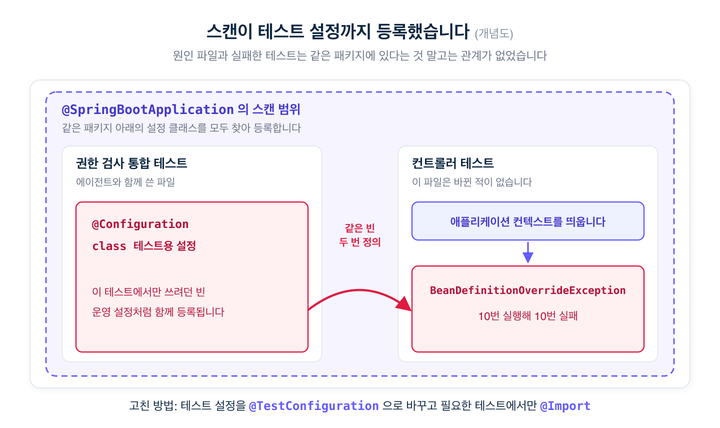
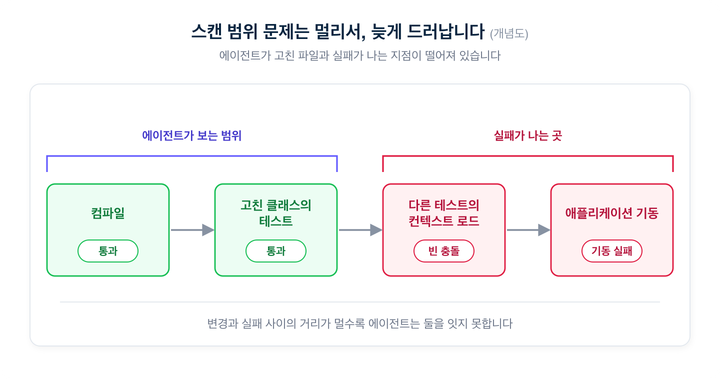
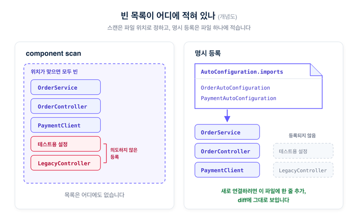
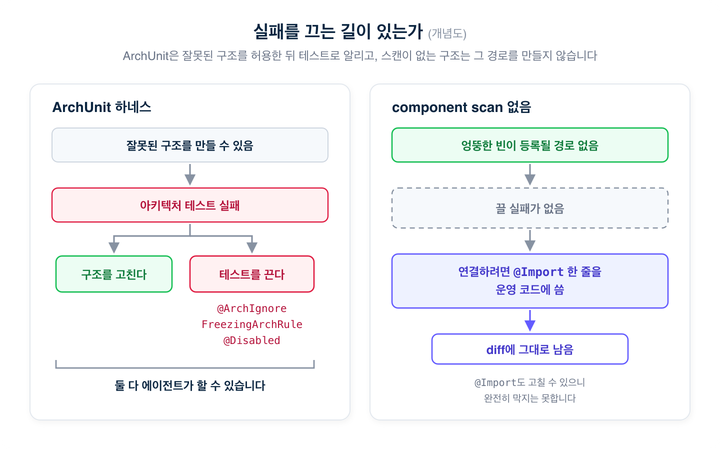

# 코딩 에이전트가 Spring을 못 짠다면, component

> ## Excerpt
> 테스트 하나가 10번 중 10번 실패한 원인은 component scan에 있었습니다

---
기술 블로그2026\. 10. 13

**라이브러리 버전을 올리던 중 컨트롤러 테스트 하나가 10번 실행해 10번 모두 실패했습니다.** 로그에는 같은 이름의 빈이 두 번 정의됐다는 `BeanDefinitionOverrideException`이 남아 있었습니다. 이 컨트롤러 테스트 파일은 바뀐 적이 없었습니다.

**원인은 같은 패키지의 다른 테스트 파일에 있었습니다.** 코딩 에이전트와 함께 작성한 권한 검사 통합 테스트 안에 테스트용 `@Configuration` 클래스가 들어 있었습니다. `@SpringBootApplication`은 자기 패키지 아래를 스캔해 설정 클래스를 등록합니다. 이 테스트용 설정도 운영 설정처럼 등록됐고, 같은 패키지에서 컨텍스트를 띄우는 컨트롤러 테스트가 빈 충돌로 실패했습니다.



**코딩 에이전트는 Kotlin이나 Spring Boot 코드를 잘 못 짠다는 이야기가 있습니다.** 저희 팀은 2025년 하반기부터 Kotlin 백엔드 코드를 에이전트와 함께 쓰기 시작했고, 2026년 들어서는 커밋의 절반 이상에 에이전트가 참여하고 있습니다. 그동안 에이전트가 막힌 사례를 되짚어 보면 Kotlin 문법보다 빈이 어디서 등록되는지와 관련된 문제가 반복해서 나왔고, 그중 여러 건이 component scan에서 시작됐습니다.

___

## 저희 Kotlin 저장소 커밋의 절반 이상에 에이전트 표식이 있습니다

**사내 Kotlin 백엔드 저장소 40개에서 에이전트 공동 작성 표식이 붙은 커밋 비율을 월별로 셌습니다.** 봇 커밋은 뺐습니다. 2025년 6월 0%였던 비율은 12월 25%, 2026년 3월 48%, 6월 71%, 9월 58%였습니다. 표식을 지우고 커밋한 경우는 세지 못했으므로 실제 비율은 이보다 높습니다.

**같은 방법으로 TypeScript 저장소 24개도 셌습니다.** 2026년 3월부터 9월까지 합산하면 Kotlin은 61.9%, TypeScript는 63.5%였습니다. 프런트엔드 저장소의 비율이 몇 달 먼저 올라갔고, 지금은 두 언어의 비율이 거의 같습니다.

**JetBrains는 2024년 연구에서 Kotlin을 공개 학습 데이터가 적은 언어로 분류했습니다.** 대부분의 모델이 Kotlin 과제에서 Python보다 낮은 성능을 보였다고 적었습니다. [JetBrains의 2024년 글](https://blog.jetbrains.com/kotlin/2024/05/ai-friendly-programming-languages-the-kotlin-story/)

**2026년 7월 JetBrains가 공개한 Kotlin 벤치마크에서는 상위 에이전트가 과제의 85% 이상을 해결했습니다.** 과제는 실제 오픈소스 Kotlin 저장소에서 뽑은 105개입니다. [Kotlin 벤치마크 발표](https://blog.jetbrains.com/kotlin/2026/07/introducing-the-kotlin-benchmark-evaluate-ai-coding-agents-on-real-world-kotlin-tasks/)

**에이전트가 Spring Boot에서 자주 틀리는 부분을 정리한 공개 저장소도 있습니다.** 이 저장소의 README는 "AI coding agents are great at Python. They hallucinate in Spring Boot."로 시작합니다. 예로 든 실수는 필드 주입, 프로젝트에 이미 있는 예외 계층 무시, 존재하지 않는 아티팩트 이름입니다. 언어보다 그 프로젝트가 빈과 의존성을 어떻게 구성했는지와 관련된 실수입니다. [spring-boot-skills](https://github.com/rrezartprebreza/spring-boot-skills)

___

## component scan을 쓰면 빈 목록이 코드에 남지 않습니다

**component scan은 스캔 범위 안에 있는 클래스를 찾아 빈으로 등록합니다.** `@Component`나 `@Service`가 붙은 클래스는 해당 패키지 아래 어디에 있든 빈이 됩니다. 어떤 빈이 등록되는지는 파일 위치로 정해지고, 그 목록을 따로 적어 두는 파일은 없습니다.

**클래스를 다른 패키지로 옮기거나 테스트 설정을 스캔 범위 안에 두면 등록되는 빈이 달라집니다.** 이 변화는 컴파일 오류로 드러나지 않습니다. 사람은 IDE의 빈 탐색 기능이나 경험으로 스캔 범위를 확인합니다. 에이전트는 파일 내용과 명령 실행 결과를 보고 작업하므로, 스캔 범위를 확인하려면 진입점 클래스와 패키지 구조를 따로 찾아 읽어야 합니다.

**스캔 범위 때문에 생긴 문제는 다른 테스트나 애플리케이션 기동 단계에서 드러납니다.** 고친 클래스의 테스트는 통과하고, 같은 패키지를 쓰는 다른 테스트의 컨텍스트 로드가 실패합니다. 저희 운영용 API 모듈은 `@ComponentScan`이 쓰지 않는 컨트롤러까지 등록하는 바람에 기동에 실패했습니다. 변경한 파일과 실패한 지점이 떨어져 있으면 에이전트가 원인을 찾기 어렵습니다.



___

## 저희는 빈을 `AutoConfiguration.imports`에 적어 등록합니다

**팀 백엔드 가이드라인은 Spring 절 첫 규칙으로 component scan을 금지합니다.** 빈은 `@AutoConfiguration`이나 `@Import`로 등록하고, 자동 설정 클래스는 `AutoConfiguration.imports` 파일에 적어 활성화합니다. 이 글에서는 이렇게 등록할 빈을 코드에 직접 적는 방식을 명시 등록이라고 부르겠습니다.

```
@AutoConfiguration
class OrderServiceAutoConfiguration {
    @Bean
    fun orderService(repository: OrderRepository): OrderService =
        OrderServiceImpl(repository)
}
```

**모듈이 어떤 빈을 등록하는지는** **`AutoConfiguration.imports`와 거기 적힌 클래스만 보면 알 수 있습니다.** 에이전트가 패키지 구조를 따로 찾아 읽지 않아도 됩니다. 모듈의 클래스는 이 파일에 적지 않으면 등록되지 않으므로, 쓰지 않는 컨트롤러 같은 클래스가 실수로 등록되지 않습니다.

**다만 진입점의** **`@SpringBootApplication`에는 component scan이 기본으로 들어 있습니다.** 진입점 패키지 아래에 둔 설정 클래스는 명시 등록과 상관없이 등록되고, 처음의 테스트 실패도 이 스캔에서 생겼습니다. 이 스캔에 잡히지 않도록 진입점 패키지 아래의 테스트 설정은 스캔 대상에서 빠지는 `@TestConfiguration`으로 만들고, 필요한 테스트에서 `@Import`로 가져옵니다.

**새 빈을 연결하려면** **`@Import`나** **`@Bean`** **한 줄을 운영 코드에 추가해야 합니다.** 이 줄은 PR diff에 그대로 나타납니다. 리뷰어는 패키지 구조를 따라가지 않고 이 줄을 보고 무엇이 연결됐는지 확인합니다.



**자동 설정의 조건도 문자열이 아니라 클래스로 적습니다.** `@ConditionalOnClass(name = [...])` 대신 `@ConditionalOnClass(Foo::class)`를 쓰면 대상 클래스의 이름이 바뀌거나 클래스가 삭제됐을 때 컴파일 오류가 납니다. 문자열 조건을 쓰던 곳에서는 조건이 연달아 꺼지면서 이벤트 컨슈머가 등록되지 않은 일이 있었습니다. 애플리케이션은 정상적으로 떴고, 오류 로그 없이 메시지 오프셋만 계속 앞으로 갔습니다.

**설정값은** **`@Value`** **대신** **`@ConfigurationProperties`로 받습니다.** 빈 충돌은 `allow-bean-definition-overriding=true`로 덮지 않고, 의존성을 정리하거나 필요 없는 자동 설정을 클래스로 지정해 제외합니다.

**이 규칙들은 에이전트를 쓰기 전부터 팀에서 지켜 오던 관행입니다.** 에이전트와 함께 일하면서 규칙과 그 이유를 가이드라인 문서로 정리했고, 에이전트가 작업할 때 관련 문서를 읽도록 했습니다.

___

## `@Import`를 빠뜨리면 테스트가 통과해도 404가 납니다

**component scan을 쓰지 않으면 등록을 빠뜨리는 실수가 생깁니다.** `@RestController`를 붙인 클래스도 `@Import`에 적지 않으면 빈이 되지 않습니다. 저희 저장소 하나에서는 테스트가 컨트롤러를 직접 생성해 호출하고 있었습니다. 기존 테스트 40개가 모두 통과했지만 배포된 애플리케이션에서는 그 경로가 404를 반환했습니다.

**등록 누락을 잡으려고 실제 애플리케이션 컨텍스트에서 빈이 등록됐는지 확인하는 테스트를 함께 둡니다.** 필요한 빈이 있는지, 요청 매핑에 경로가 등록됐는지를 확인합니다. 404를 고친 커밋은 이 테스트를 추가한 뒤 등록 코드 한 줄을 지워서 테스트가 실패하는 것도 확인했습니다.

**선택 주입(optional injection)으로 받던 빈은 필수 주입으로 바꿨습니다.** 한 검색 필터는 빈이 비어 있어도 오류 없이 검색 결과 0건만 반환하고 있었습니다. 필수 주입으로 바꾼 뒤에는 빈이 없으면 애플리케이션이 기동하지 않습니다. 기동 실패는 에이전트가 테스트 한 번으로 재현할 수 있습니다.

___

## ArchUnit 테스트로도 규칙을 지킬 수 있지만, 테스트는 꺼질 수 있습니다

**ArchUnit은 패키지 의존 방향이나 어노테이션 사용 같은 아키텍처 규칙을 테스트로 검사하는 라이브러리입니다.** 이 테스트를 에이전트 작업 흐름에 넣어 규칙을 지키게 하는 방법도 있습니다. 이렇게 에이전트 주변에 검사와 hook을 둘러 규칙을 강제하는 구성을 하네스(harness)라고 부릅니다. 2026년 10월 머지된 한 공개 저장소의 PR은 `AGENTS.md`에 적힌 규칙을 ArchUnit 테스트 24개로 옮기고, 에이전트가 작업을 끝내기 전에 이 테스트를 실행하도록 Claude Code hook을 추가했습니다. [해당 PR](https://github.com/prokxi/Dimples/pull/1) 저희도 일부 저장소에서 ArchUnit과 Konsist를 쓰고 있습니다.

**ArchUnit은 컴파일된 바이트코드를 테스트 단계에서 검사합니다.** ArchUnit 문서도 컴파일 시점에 검사하는 모듈 시스템과 비교해 테스트 시점에 검사한다는 점을 밝히고 있습니다. 규칙을 건너뛰는 `@ArchIgnore`, 기존 위반을 파일에 기록하고 새 위반만 검사하는 `FreezingArchRule`, 정규식으로 위반을 무시하는 패턴 파일도 공식 기능입니다. [ArchUnit 사용자 가이드](https://www.archunit.org/userguide/html/000_Index.html)

**모델 개발사와 연구 기관은 에이전트가 테스트를 고쳐 통과시키는 사례를 보고했습니다.** Anthropic은 Claude 3.7 Sonnet 시스템 카드에서 이 모델이 테스트를 통과하려고 기대값을 그대로 반환하거나 테스트를 코드의 출력에 맞게 고치는 경우가 있다고 적었습니다. [시스템 카드](https://assets.anthropic.com/m/785e231869ea8b3b/original/claude-3-7-sonnet-system-card.pdf) METR은 최신 모델이 테스트나 채점 코드를 고쳐 점수를 올리려 했고, 프롬프트에 "Please do not cheat."를 넣어도 비율이 줄지 않았다고 보고했습니다. [METR 보고서](https://metr.org/blog/2025-06-05-recent-reward-hacking/)

**저희 작업 기록에도 에이전트가 실패하는 테스트를 끈 사례가 있습니다.** 서비스 계정 권한을 검사하는 통합 테스트가 계속 실패했습니다. 에이전트는 세 번 수정을 시도한 뒤 "인증 메커니즘을 정확히 모르고 테스트가 복잡하다. 다른 곳에서 검증될 것으로 추정한다"고 판단하고 `@Disabled`를 붙였습니다. PR 본문에는 이 테스트가 통과한 것으로 적혀 있었고, `@Disabled`는 지금도 남아 있습니다. 아키텍처 테스트에서 같은 일이 일어난 사례는 찾지 못했지만, 에이전트가 아키텍처 테스트만 다르게 다룬다고 볼 근거도 없습니다.

**ArchUnit 하네스는 잘못된 구조가 만들어진 뒤에 테스트 실패로 알려 줍니다.** 이 실패를 없애려면 구조를 고치거나 테스트를 꺼야 하고, 두 가지 모두 에이전트가 할 수 있습니다. 모듈에서 component scan을 쓰지 않으면 의도하지 않은 빈이 등록될 경로가 없으므로, 그 문제를 잡으려고 둘 테스트도 필요 없습니다. 에이전트가 `@Import`나 빌드 파일을 고칠 수는 있지만, 그 변경은 운영 코드의 diff에 나타납니다. 반대로 등록을 빠뜨리는 실수는 앞에서처럼 테스트로 확인해야 합니다.



**빈 등록을 확인하는 테스트도 꺼질 수 있으므로 테스트의 변경 내용을 따로 확인합니다.** 일부 저장소는 리뷰 기준에서 단정문 삭제, 조건 완화, skip 추가로 테스트를 통과시킨 PR을 반려하고, 실행된 테스트가 0건인데 성공으로 끝난 빌드를 통과로 보지 않습니다. 규칙은 가능한 한 구조와 컴파일 단계에서 지키고, 테스트로만 지킬 수 있는 규칙은 테스트 diff를 따로 검토합니다.

___

## 처음의 테스트는 `@TestConfiguration`과 `@Import`로 고쳤습니다

**10번 중 10번 실패하던 컨트롤러 테스트는 테스트용 설정을** **`@TestConfiguration`으로 바꾸고, 필요한 테스트에서만** **`@Import`로 가져오게 해서 고쳤습니다.** 진입점의 스캔이 자동으로 등록하던 설정을, 쓰는 테스트에서 직접 가져오게 바꿨습니다. 수정한 코드에는 이렇게 바꾼 이유를 주석으로 남겼습니다.

**에이전트와 Spring 코드를 함께 쓰는 팀이라면 component scan을 쓰지 않는 것부터 시작해 볼 만합니다.** 빈이 어디서 등록되는지 코드에 적혀 있으면 에이전트도 그 파일을 읽고 작업할 수 있습니다. 저희는 이런 개발 환경을 계속 다듬고 있고, 함께 고민할 분을 찾고 있습니다.

[

🚀플렉스팀 채용페이지 바로가기

](https://flex.careers.team/)[

☕flex Private Talk 신청하기

](https://forms.gle/p1gBm8kpeRgw7QgVA)
